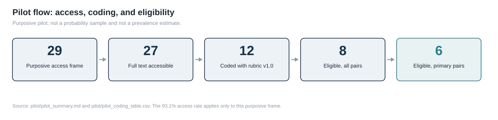

# Does Benchmark Critique Diffuse into Evaluation Practice?

**A Pilot-Based Study of EvalPlus and SWE-bench+ Adoption**

**PILOT-STUDY PREPRINT — NOT A COMPLETED FULL-SCALE STUDY**

**Author:** Syed Abdul Aman (Independent Researcher)  
**Version:** 1.0, 15 November 2026  
**Typeset paper:** [paper.pdf](paper.pdf) · **LaTeX source:** [paper.tex](paper.tex)  
**Evidence base:** a frozen citation frame of 2,666 title clusters plus a purposive 29-paper pilot (27 accessible, 12 coded, 8 eligible for all pairs, 6 eligible for the two primary pairs)

> **Read this first.** This manuscript is the Markdown companion to the typeset PDF. It reports a pilot, not a population study. The pilot was purposive, the eligible samples are six and eight papers, and the reliability statistics are LLM–LLM agreement rather than human inter-rater reliability. The paper does **not** estimate the prevalence of adoption in the 2,666-paper frame, does **not** establish causal diffusion, and has **not** been peer reviewed. It is a complete report of the pilot, instrument, and evidence. The 900-paper study described in Section 6 was designed but not executed.

## Abstract

Benchmark critiques identify concrete defects in widely used evaluations and often release a remediation: augmented tests, a filtered dataset, or a stronger protocol. Citation counts record that a critique was noticed, but not whether citing papers changed their own evaluation practice. This paper reports a pilot study of documented adoption for two remediations in code-generation research: EvalPlus, which augments HumanEval and MBPP tests, and SWE-bench+, which releases a filtered 548-instance dataset for SWE-bench. We combine a frozen citation frame of 2,666 title clusters with a purposive 29-paper pilot. Twenty-seven full texts were accessible, 12 papers were coded, 8 were eligible for the all-pair set, and 6 for the two primary pairs. Rubric v1.1 distinguishes citation only (0), acknowledgment (1), partial adoption (2), and full adoption (3), with full adoption requiring the critique's artifact or protocol to support a main claim. One of six primary-pair papers fully adopted the remediation (16.7%; Wilson 95% CI 3.0–56.4); the all-pair estimate was 1/8 (12.5%; 2.2–47.1). Three of six primary-pair papers independently remediated the benchmark without adopting the critique's artifact, and none of the three SWE-bench+ cases used the 548-instance dataset. Agreement was assessed between two LLM coding passes (ordinal κ = 0.78 unweighted, 0.86 linear weighted) and is not human inter-rater reliability. The pilot is purposive and small; it does not estimate population prevalence or identify causal diffusion. Its contribution is a transparent instrument, explicit boundary rules, and evidence that citation, acknowledgment, and adoption are empirically distinct.

**Keywords:** benchmark evaluation; benchmark critique; EvalPlus; SWE-bench+; citation diffusion; meta-research; reproducibility; code generation

---

## 1. Introduction

Benchmarks are not neutral yardsticks. They encode decisions about tasks, tests, and what counts as a solution, and those decisions become consequential when leaderboards and papers treat a benchmark score as a statement about capability. It is therefore unsurprising that widely used code-generation benchmarks have attracted detailed critiques. HumanEval and MBPP rely on relatively small sets of hand-written tests; stronger tests expose programs that pass the originals but are incorrect (Liu et al., 2023). SWE-bench and its variants can reward patches that exploit solution leakage or satisfy weak tests; filtering the instance set lowers measured resolution rates substantially (Aleithan et al., 2024).

These critiques are not only diagnostic. They release concrete remediations: augmented test suites, filtered datasets, and stronger evaluation protocols. Whether a critique changes practice is a separate question from whether it is cited. A paper can cite a critique in a related-work paragraph, acknowledge that a benchmark has known problems, and then report its main result on the original benchmark unchanged. That pattern is familiar to anyone who has read evaluation sections closely, but it has not been systematically measured for code-generation benchmarks. Citation counts conflate awareness with use. They cannot distinguish a paper that cites a critique as background from a paper that rebuilds its evaluation around the critique's remedy.

This paper asks a deliberately narrow question:

> Among research papers that cite a benchmark-remediation critique, what proportion document adopting the critique's recommended benchmark or protocol in their own evaluation of the criticized benchmark?

The outcome is *documented adoption*, scored on a four-level rubric: citation only (0), acknowledgment (1), partial adoption (2), and full adoption (3). The binary primary outcome is full adoption. "Documented" is deliberate. The study measures what a paper's text, tables, and captions state, not whether an artifact was executed correctly. Execution fidelity is a separate construct, and one that the present design does not observe.

The two primary pairs are EvalPlus with HumanEval and MBPP, and SWE-bench+ with SWE-bench, Lite, or Verified. GSM1k with GSM8K is retained only as a secondary task-fit contrast and is excluded from the primary denominator. The primary pairs are useful because both critiques are public and licensed, yet their adoption costs differ. EvalPlus is comparatively close to a drop-in test augmentation: a lab can run HumanEval+ or MBPP+ with a public harness and report pass rates. SWE-bench+ requires a filtered 548-instance dataset, harness reconciliation, and re-running agents. If adoption is low even for a low-cost remediation, cost is not the whole story. If EvalPlus adoption exceeds SWE-bench+ adoption, the contrast is consistent with compatibility and integration cost as candidate explanations. The pilot cannot test those explanations causally. It can show whether the categories are distinguishable and whether the contrast is worth a full study.

This paper reports a pilot. It combines a frozen citation frame of 2,666 title clusters with a purposive 29-paper access frame, 27 accessible full texts, 12 coded papers, and 8 or 6 eligible papers depending on the pair set. The full-scale study—a stratified sample of 900 invited papers, human double-coding, and pre-specified sensitivity analyses—was designed but not executed. We therefore report descriptive counts and intervals rather than prevalence estimates, and we treat the pilot as a test of the instrument and the coding workflow.

The paper makes four contributions:

1. **A measurement instrument.** Rubric v1.1 operationalizes documented adoption as a four-level ordinal construct and separates citation, acknowledgment, partial adoption, and full adoption. It includes boundary rules for generic contamination talk, independent remediation, derivative benchmarks, and appendix-only use.
2. **A frozen citation frame.** The frame contains 2,666 title clusters derived from 2,572 EvalPlus citation rows and 136 SWE-bench+ citation rows, with identifier and title deduplication documented and hashed.
3. **A pilot demonstration.** The pilot shows that the categories are empirically distinguishable: the six primary-pair papers split into 2 citation-only, 3 acknowledged, 0 partial, and 1 full adoption. It also shows that independent remediation is common enough to require separate coding.
4. **A transparent account of the evidence base.** The pilot does not support a prevalence claim, and the paper says so. The full-scale study is specified, but its central estimate remains unmeasured.

The contribution is therefore not "the first estimate of benchmark-critique diffusion." It is a defensible instrument and a pilot that justify, but do not replace, the full study.

Section 2 positions the study against related work. Section 3 characterizes the two remediations and the cost contrast. Section 4 presents the conceptual framework. Section 5 describes the frame, pilot sampling, rubric, and reliability procedure. Section 6 describes the planned full-scale study and states that it was not executed. Section 7 reports the pilot results. Sections 8 and 9 discuss the findings, validity, and limitations. Section 10 covers ethics, licensing, and data availability; Section 11 documents reproducibility; Section 12 concludes.

## 2. Related Work

### 2.1 Citation as a concept symbol, not a use claim

Small (1978) argued that cited documents function as concept symbols: a citation signals that a paper belongs to a conversation, not that its specific claims were implemented. That distinction is central here. A citation to EvalPlus can mean that the authors know tests are imperfect, that they use HumanEval+, or simply that this is the standard reference for test augmentation. Citation counts cannot tell these apart.

Diffusion-of-innovations research adds a second distinction: adoption is a process, not a binary event. Rogers (2003) describes awareness, persuasion, decision, implementation, and confirmation, and emphasizes that adopters may reinvent an innovation rather than implement it as specified. Our four-level rubric is a stripped-down observational analogue: citation (awareness), acknowledgment (persuasion or decision without implementation), partial adoption (implementation in a secondary role), and full adoption (implementation in the primary evaluation). The analogy is conceptual. It is not a validation of Rogers's stage model, and the pilot does not measure persuasion or confirmation.

### 2.2 Benchmark validity and remediation

The benchmark-validity literature has documented several distinct failure modes. Dehghani et al. (2021) show that benchmark rankings are sensitive to benchmark choice and construction. Kapoor and Narayanan (2023) document leakage and reproducibility failures across machine-learning-based science, including benchmarks used to support claims. EvalPlus shows that HumanEval and MBPP tests are too weak: stronger tests reduce pass rates and expose incorrect programs (Liu et al., 2023). SWE-bench+ reports that a substantial share of successful SWE-bench patches involve solution leakage or weak tests, and that filtering changes measured resolution rates (Aleithan et al., 2024).

These critiques differ in what they recommend. Some recommend a new artifact (HumanEval+, MBPP+, the SWE-bench+ dataset); some recommend a protocol (filtering, strengthened tests); some recommend a parallel benchmark (GSM1k). Our study treats the recommendation as part of the critique's identity. Adoption means using the critique's recommended artifact or protocol, not merely agreeing that the original benchmark is flawed.

### 2.3 Benchmark quality assessment versus adoption

BetterBench assesses benchmark quality across a lifecycle and evaluates a set of AI benchmarks against best-practice criteria (Reuel et al., 2024). That work answers: how good is this benchmark? Our question is different: given a critique that identifies a defect and releases a remediation, do later papers use the remediation? A benchmark can score well on a quality framework and still fail to diffuse; a critique can be methodologically strong and still be cited without being used. BetterBench and related quality frameworks are therefore complements, not competitors.

### 2.4 Access, adoption, and the closest prior work

The closest prior work is Merzah's (2026) replication materials for "Cited but Not Used: Documented Adoption and Data Accessibility in 40 Non-English NLP Benchmarks." Those materials study 40 non-English NLP benchmarks, 487 citation records, accessibility and licensing, and include coding and reliability instruments. They are unpublished replication materials, not a peer-reviewed paper, and they focus on a different domain and a different outcome. Our study differs in domain (code-generation benchmarks), design (a citation-frame audit of citing works), outcome (an ordinal adoption rubric with evidence quotes and adoption locus), and contrast (a low-cost test augmentation versus a high-cost dataset filtering).

We did not locate a published study that estimates documented adoption of EvalPlus or SWE-bench+ among their citing papers. That is a statement about our search, not a priority claim. The relevant searches, dates, and links are recorded in the repository's verification files. A systematic novelty search should be repeated before submission.

### 2.5 What is new here

The new element is not the observation that some papers cite without using. It is the combination of:

- a citation-frame design that starts from all citing works rather than from a hand-picked benchmark sample;
- an ordinal adoption rubric with explicit boundary rules and verbatim evidence;
- a comparative contrast between a low-cost test augmentation and a high-cost dataset remediation;
- a frozen, reproducible frame and an open coding instrument.

The pilot tests whether that combination is workable. It does not establish that the resulting estimate is precise or generalizable.

## 3. The Remediations and the Cost Contrast

### 3.1 EvalPlus and HumanEval/MBPP

EvalPlus (Liu et al., 2023) argues that HumanEval (Chen et al., 2021) and MBPP (Austin et al., 2021) tests are insufficiently rigorous: programs can pass the original tests while being incorrect. It releases HumanEval+ and MBPP+ with augmented tests and a public harness. The verified artifact facts are: Apache-2.0 license; 80× more tests for HumanEval+; 35× more tests for MBPP+; 378 MBPP+ tasks after v0.2.0; and a reported reduction in pass@k of up to 19.3–28.9% on HumanEval+ (Liu et al., 2023). These are artifact and paper facts, not claims about adoption.

For a citing paper, adoption can be relatively low-friction: run the public harness on HumanEval+/MBPP+ and report pass rates. That does not make adoption automatic. A lab may have an existing pipeline, may compare to prior numbers on the original benchmark, or may use the augmented tests only as a robustness check. But the artifact is compatible with the original task format, which makes EvalPlus a useful low-cost case.

### 3.2 SWE-bench+ and SWE-bench/Lite/Verified

SWE-bench+ (Aleithan et al., 2024) argues that SWE-bench evaluation (Jimenez et al., 2023), including its Lite and Verified variants (OpenAI, 2024), is affected by solution leakage and weak tests. The critique reports that 32.67% of successful patches involve solution leakage and 31.08% of passed patches are suspicious due to weak tests; after filtering, the resolution rate falls from 12.47% to 3.97%. It releases a 548-instance curated dataset on Zenodo under CC BY 4.0 (SWE-bench+ dataset, 2024). No peer-reviewed venue record for the critique was located in the checks performed; it is described as an arXiv preprint.

Adoption requires more than adding a test file: the paper must use a different instance set, reconcile the harness, and re-run agents. A lab may reasonably decide that the original SWE-bench number is the comparable one, or may build its own filtering protocol. Those decisions are exactly what the rubric is designed to distinguish: acknowledgment (1), independent remediation (1 with the independent-remediation flag), partial adoption (2), or full adoption (3).

### 3.3 GSM1k and GSM8K (secondary only)

GSM1k (Zhang et al., 2024) is a parallel arithmetic benchmark designed to mirror GSM8K's style and complexity; the paper reports accuracy drops of up to 8% on GSM1k. The Hugging Face dataset has 1,205 rows and a blank license field (GSM1k dataset, 2025). GSM1k is excluded from the primary denominator for four reasons: task fit (it is not a drop-in replacement for GSM8K), availability timing (the full dataset appeared in 2025, after many frame papers were written), license ambiguity, and comparability (the construct is a contamination-controlled parallel benchmark, not a direct remediation of GSM8K). It is retained only as a secondary contrast, and its pilot rows are never pooled into the primary estimate.

### 3.4 Why the contrast is informative

Both primary critiques are public and licensed, so adoption is not blocked by paywalls or missing artifacts. Their remediation costs differ. If EvalPlus adoption is high and SWE-bench+ adoption is low, the difference is consistent with compatibility and integration cost. If both are low, the problem is broader than tooling. If both are high, citation-based concerns about "critique without practice" are less pressing, at least for these pairs. The pilot has three papers per pair, so it can illustrate these possibilities but cannot choose among them.

**Table 1. Benchmark pairs and remediation characteristics.** Cost is an analytic characterization, not a measured implementation time.

| Pair and critique | Benchmarks and recommended practice | Artifact facts | Cost and role |
|---|---|---|---|
| P1. EvalPlus (Liu et al., 2023) | HumanEval and MBPP. Use HumanEval+ and MBPP+ augmented tests as the primary evaluation. | Public GitHub harness; Apache-2.0; 80× tests for HumanEval+, 35× for MBPP+; 378 MBPP+ tasks. | Low: drop-in test suite and harness. Primary pair. |
| P2. SWE-bench+ (Aleithan et al., 2024) | SWE-bench, Lite, and Verified. Use the 548-instance curated dataset and/or strengthened-test protocol as the primary evaluation. | Public Zenodo dataset; CC BY 4.0; 548 instances. | High: filtered instances, harness reconciliation, and agent re-runs. Primary pair. |
| S1. GSM1k (Zhang et al., 2024) | GSM8K. Use GSM1k or a fully equivalent contamination-controlled replication. | Public Hugging Face dataset; 1,205 rows; license field blank. | Medium: parallel benchmark, not a drop-in replacement. Secondary only. |

*Note.* GSM1k is excluded from the primary denominator; its rows are reported only as a task-fit contrast.

## 4. Conceptual Framework

### 4.1 The adoption ladder

We treat documented adoption as a four-level ordinal construct. Level 0 is *citation only*: the critique appears in the reference list, but the body does not discuss its specific finding or recommendation, and the criticized benchmark is used unchanged. Level 1 is *acknowledged*: the body mentions the critique's specific finding—test insufficiency, solution leakage, contamination—but the evaluation is unchanged. Level 2 is *partial adoption*: at least one recommended practice is applied to the criticized benchmark, but not the core remediated artifact or protocol for the main results. Level 3 is *full adoption*: the core remediated artifact or protocol supports at least one main table, figure, or claim, with at least one reported result and the critique cited as the basis.

The levels are ordered by proximity to the critique's recommended practice, not by research quality. A paper can be excellent and still score 0 if it cites the critique only as background. A paper can score 3 while implementing the artifact incorrectly; execution fidelity is a separate construct. The rubric's definitions and boundary rules appear in Section 5.6 and Table 4.

### 4.2 Adjacent outcomes

Two adjacent outcomes complicate the ladder. *Independent remediation* occurs when a paper builds its own stronger tests or filtering protocol without using the critique's artifact. This is good evaluation practice, but it is not diffusion of the critique's remedy. The rubric codes it separately and does not award score 2 or 3 for it. *Derivative benchmark use* occurs when a paper evaluates SWE-bench Pro, CWEval, or another derivative instead of SWE-bench/Lite/Verified. That is not evidence about the criticized benchmark and is ineligible, not a low score.

### 4.3 Observational boundary

The framework is observational. A citation and a documented artifact use can co-occur because the authors were persuaded by the critique, because the artifact is the default in their lab, because a reviewer asked for it, or because the paper was written after the artifact became standard. The study can describe the joint distribution; it cannot identify the reason. The discussion therefore uses mechanism language ("consistent with," "may reflect") rather than causal language.

## 5. Study Design and Methods

### 5.1 Design overview

The project has three components. First, *frame construction*: a frozen citation frame of works citing EvalPlus or SWE-bench+, retrieved from the Semantic Scholar Graph API on 13 November 2026. Second, a *pilot*: a purposive 29-paper access frame, 27 accessible full texts, 12 coded papers, and 8 eligible all-pair or 6 eligible primary-pair papers. The pilot tests the rubric, access, and coding workflow. Third, a *full-study plan*: a stratified design of 900 invited papers (135 SWE-bench+ census plus 765 EvalPlus-only) with a stop rule and a pre-specified analysis plan. The full study has not been executed.

The unit of analysis is a title-level citing work × critique. A paper that cites both critiques gets two rows. A paper that evaluates multiple criticized benchmarks gets one score per critique, based on the highest-adoption use that supports a main claim; benchmark-level details are recorded in secondary fields.

### 5.2 Data sources

The study uses the Semantic Scholar Graph API for citation records and metadata; arXiv for preprints and full texts where available; publisher pages, DOIs, and author copies for published versions; GitHub and Zenodo for artifact metadata and licenses; and official benchmark repositories for version information. The pilot used the retrieved full texts and recorded evidence quotes. It did not use a commercial full-text database, and it did not bypass paywalls. The frame is a Semantic Scholar snapshot; it is not a census of all literature.

### 5.3 Citation-frame construction

The frame is a snapshot of works citing the two critique papers, retrieved from the Semantic Scholar Graph API on 13 November 2026. The retrieval returned 2,572 EvalPlus citation rows and 136 SWE-bench+ citation rows. Semantic Scholar reported 2,573 EvalPlus citations; one row was not returned. The raw sum is 2,708 rows.

Two deduplication steps were applied. First, an identifier union-find merged records if they shared a DOI (lowercased), arXiv ID, DBLP key, CorpusId, or Semantic Scholar paperId, with transitive closure. This produced an identifier-deduplicated union of 2,684 records, an intermediate count rather than the analysis frame. Second, normalized titles were produced by lowercasing, replacing non-alphanumeric characters with spaces, and collapsing whitespace. Identical normalized titles were merged into one cluster. A representative record was chosen by preferring a DOI, then an arXiv ID, then the earliest year, then paperId. All source labels were unioned into the cluster.

Title clustering produced 2,666 clusters. Fourteen multi-variant clusters accounted for 18 extra rows. The final frame has 135 clusters in the SWE-bench+ census stratum (112 SWE-only plus 23 citing both critiques) and 2,531 in the EvalPlus-only stratum. The 23 both-critique clusters are assigned to the SWE-bench+ census so that the small stratum is a complete census. Table 2 profiles the frame.

The year distribution is 2022: 2; 2023: 119; 2024: 526; 2025: 838; 2026: 1,139; unknown: 42. DOI coverage is 2,313 clusters, arXiv coverage is 2,028, DBLP coverage is 2,129, and 42 clusters have none of DOI, arXiv, or DBLP. Two hundred twenty-five clusters have no publication date, 231 have a publication date after 30 September 2026 (likely forthcoming issue dates), and 14 clusters have multiple title variants. These are reported, not silently dropped. The source frame SHA-256 is `46a58fe0…cd772`; the analysis CSV SHA-256 is `4650ce1b…705a0`. Both are recorded in the repository.

**Table 2. Frozen citation-frame profile.** The identifier-deduplicated union is an intermediate count, not the analysis frame.

| Quantity | Count | Note |
|---|---:|---|
| Raw EvalPlus citation rows | 2,572 | Semantic Scholar reports 2,573; one row not returned. |
| Raw SWE-bench+ citation rows | 136 | Semantic Scholar reports 136. |
| Raw sum | 2,708 | Before deduplication. |
| Identifier-deduplicated union | 2,684 | Intermediate count; not the analysis frame. |
| Title-deduplicated clusters | **2,666** | Frozen analysis frame. |
| SWE-bench+ census stratum | 135 | Includes 23 clusters citing both critiques. |
| EvalPlus-only sample stratum | 2,531 | Sampled in the planned main design. |
| Clusters citing both critiques | 23 | Assigned to the SWE-bench+ census. |


**Figure 1. The frozen citation frame by publication year.** The 2026 bar is incomplete and includes 231 records with future-dated publication metadata; 42 clusters have no publication year. Source data: `figures/fig1_frame_years.csv`.

The frame is a Semantic Scholar-indexed citation snapshot, not a census of all papers that cite either critique. It misses non-indexed venues, papers with incomplete metadata, and citations added after 13 November 2026. The 2026 portion is incomplete. Title clustering merges preprints and published versions with identical normalized titles, but it can also merge distinct works with identical titles; the 14 multi-variant clusters require manual review before the full study. The frame is frozen. A post-freeze citation refresh may be reported as a sensitivity analysis but cannot change the sampling frame. This prevents denominator drift and selective inclusion. The pilot reports a PRISMA-informed flow (Page et al., 2021), but it is not a full systematic review; the flow is used to make exclusion and access decisions auditable rather than to claim PRISMA compliance.

### 5.4 Pilot sampling and eligibility

The pilot used a purposive 29-paper access frame assembled from papers citing EvalPlus, SWE-bench+, or GSM1k. The papers were selected to cover different benchmarks and likely adoption levels, not to represent the frame. Twenty-seven full texts were accessible (93.1%), 12 papers were coded, 8 were eligible for the all-pair set, and 6 were eligible for the two primary pairs. Four of the 12 coded papers were ineligible. Of the 27 accessible papers, 15 were not coded after category saturation; the two inaccessible papers were not coded. Table 3 and Figure 2 report the flow.

**Table 3. Pilot flow.** The access rate applies only to the purposive 29-paper frame.

| Stage | n | Note |
|---|---:|---|
| Purposive access frame | 29 | Selected for construct coverage, not randomly. |
| Full text accessible | 27 | 93.1% of the purposive frame; not generalizable. |
| Coded with rubric | 12 | Evidence quotes recorded. |
| Eligible, all pairs | 8 | Includes two GSM1k secondary rows. |
| Eligible, primary pairs | 6 | EvalPlus and SWE-bench+ only. |
| Ineligible | 4 | No evaluation of the criticized benchmark. |
| Inaccessible and not coded | 2 | Not counted as non-adopters. |



**Figure 2. Pilot flow from the 29-paper purposive frame to the six primary-pair eligible papers.** The 93.1% access rate applies only to this purposive frame. Source data: `figures/fig2_pilot_flow.csv`.

A paper is eligible only if all three conditions hold: **E1**, it reports empirical evaluation results on the criticized benchmark (HumanEval, MBPP, SWE-bench, SWE-bench Lite, or SWE-bench Verified); **E2**, it contains a bibliographic citation to the critique; and **E3**, a full text is available in English with enough methods and results detail to code. Failure codes are `INELIGIBLE_NO_EVAL`, `INELIGIBLE_NO_CITATION`, `UNCODABLE_ACCESS`, and `UNCODABLE_LANGUAGE`. Eligibility is decided before scoring. An ineligible paper receives no 0–3 score; its score field is blank in the source coding table.

A paper evaluating only a derivative benchmark (for example, SWE-bench Pro or CWEval) but not the criticized benchmark is ineligible. A paper evaluating both the original and a derivative is eligible; the original is coded. A paper that constructs a new benchmark by sampling problems from HumanEval+ or MBPP+ is eligible only if it reports evaluation results on those sampled problems; this is recorded as a derived-benchmark flag.

The four ineligible pilot papers illustrate the boundary rules: `swebenchpro` evaluates SWE-bench Pro, a derivative, not SWE-bench/Lite/Verified; `cweval` evaluates CWEval and cites EvalPlus only as future work; `hafix` cites Aleithan et al. in a generic bug-fixing list and does not evaluate SWE-bench/Lite/Verified; and `demystifying` cites Zhang et al. in a generic claim and does not evaluate GSM8K. Ineligible papers receive no score. Their blank score fields in the pilot coding table are not outcomes.

The pilot's 93.1% access rate is a feasibility signal, not an estimate for the 2,666-paper frame. A 335-record feasibility cohort was drawn later (135 SWE-bench+ census plus 200 EvalPlus-only, seed `20261113`, frame SHA-256 `6a0a374b…`) to test retrieval on a larger set. Retrieval was halted before completion and no cohort records were coded. The cohort is a documented deviation from the planned 900-paper design and contributes no results to this paper. The partial retrieval produced no coding table, no adoption scores, and no denominator for inference.

### 5.5 Coding procedure

The coder reads the title and abstract, retrieves the full text, confirms E1–E3, searches for the critique's author names, title, arXiv ID, artifact name, and benchmark names, and reads the citation context plus the methods and main results. The coder assigns a score and secondary fields, records a verbatim evidence quote of at most 60 words and its section or table, and flags ambiguity for adjudication. Scores of 1 or higher cannot be assigned from an abstract alone.

The pilot coding table records the paper key, title, venue, year, critique, eligibility, ineligibility reason, score, engagement, independent remediation, evidence quote, and notes. It does not record page numbers for every quote; the full study's coding form requires a section or table locator. This is a limitation of the pilot record, not a feature of the instrument.

### 5.6 Rubric and boundary rules

Table 4 gives the rubric. The binary primary outcome is full adoption (score 3). Scores 0–2 are non-adoption for the primary estimate. Partial adoption is reported separately and tested as a sensitivity analysis (2+3 versus 0+1).

**Table 4. Rubric v1.1 for documented adoption.** Scores are ordered by proximity to the critique's recommended practice, not by research quality.

| Score | Label | Definition | Typical evidence |
|---:|---|---|---|
| 0 | Citation only | The critique appears in the reference list, but the body does not discuss its specific finding or recommendation; the criticized benchmark is used unchanged. A generic mention of "contamination" or "leakage" in a citation cluster is 0. | Reference entry; generic related-work sentence with no specific claim. |
| 1 | Acknowledged | The body mentions the critique's specific finding (test insufficiency, solution leakage, contamination) but the evaluation is unchanged: original instances or tests, no filtering, no augmented tests, no contamination-controlled replication. | "Liu et al. report gaps in HumanEval's tests; we use the original HumanEval." |
| 2 | Partial adoption | At least one recommended practice is applied to the criticized benchmark, but not the core remediated artifact or protocol for the main results. Examples: HumanEval+ only in an appendix or robustness check while the main table uses HumanEval; SWE-bench+ filtering applied to a subset or a secondary analysis. | Main table uses HumanEval; appendix reports HumanEval+. |
| 3 | Full adoption | The core remediated artifact or protocol is used for the paper's primary evaluation of the criticized benchmark, with at least one reported result and the critique cited as the basis. | Main table uses HumanEval+/MBPP+; main SWE-bench table uses the 548-instance SWE-bench+ set or its protocol. |

*Note.* The full rubric, worked cases, and coding form are in [`rubric_v1.1.md`](../rubric_v1.1.md).

The boundary rules are intended to make the score reproducible rather than intuitive. Citation is not adoption: a reference-list entry alone is 0. Generic contamination talk is not acknowledgment: if the paper says contamination is a concern and cites the critique in a cluster but never states the critique's specific finding or implication for its own evaluation, the score is 0. Acknowledgment requires specificity: a sentence that names the critique's finding and leaves the evaluation unchanged is 1. Independent remediation is not adoption: an independently designed stronger test suite is not the critique's artifact; the paper scores 1 if the finding is discussed and the independent-remediation flag is set. Full adoption requires the main evaluation: if the augmented or filtered benchmark is only a secondary check, the score is 2; if it supports at least one main claim, table, or figure, the score is 3. When the original and augmented benchmarks are co-primary, the score is 3 if the augmented result supports at least one main claim. Derivative-only papers are ineligible. Benchmark version is recorded, not scored. Code inspection can corroborate but not upgrade a score, because the construct is documented adoption. Self-citation is coded normally and flagged for a sensitivity analysis. Unresolved ambiguity receives a low-confidence flag, goes to adjudication, and uses the conservative lower score if still unresolved.

### 5.7 Reliability

The full-study plan requires a human second coder for 20% of eligible papers, stratified by critique and score band, with percent agreement and Cohen's κ for eligibility, unweighted and linear-weighted κ for the ordinal score, and bootstrap confidence intervals (Cohen, 1960). The threshold is weighted κ ≥ 0.60 for the main analysis; 0.40–0.59 requires a limitation; below 0.40 triggers retraining and recoding.

The pilot did not meet this standard. Its two coding passes were LLM annotations with fresh context. Eligibility agreement was 12/12; ordinal agreement was 7/8; unweighted κ was 0.78 and linear-weighted κ was 0.86. The single disagreement was `promptcot`: the first pass scored 0, the second pass proposed 1, and adjudication chose 0 under the generic-cluster rule. These are LLM–LLM agreement statistics. They are useful for debugging the rubric, not for a human reliability claim. No human second coder coded the pilot. The exact model identifier, prompt, and temperature were not preserved in the pilot record; this is a documentation gap that the full study must fix. The primary-pair subset had no ordinal disagreements (6/6), but six cases are too few to estimate reliability, and a 6/6 agreement rate must not be reported as a reliability result.

### 5.8 Analysis

The pilot analysis reports counts, score distributions, Wilson 95% intervals (Wilson, 1927), pair-specific descriptive estimates, engagement, and independent remediation. It computes exact-binomial diagnostics for the pre-specified H1 and H3 thresholds but does not use them for confirmatory inference. Wilson intervals are used because they behave better than Wald intervals when proportions are near 0 or 1 and when n is small. The full-study analysis adds design weights, a stratified bootstrap, sensitivity analyses, and access-bias bounds. Section 6 gives the details.

### 5.9 Deviations and study status

The full registered design is 900 invited papers (135 SWE-bench+ census plus 765 EvalPlus-only). It was not executed. A 335-record feasibility cohort was drawn to test retrieval, but retrieval was halted before completion and no feasibility-cohort records were coded. The cohort is a documented deviation from the registered design, not a substitute sample, and it contributes no results to this paper. The pilot's 29-paper frame was purposive. Its 93.1% access rate is therefore a feasibility signal, not an estimate of general access.

## 6. The Planned Full-Scale Study

This section describes a design that has not been executed. We separate it from the pilot so that planning assumptions are not mistaken for findings.

The full study is designed as a stratified random sample with a census of the small SWE-bench+ stratum. Table 5 gives the allocation. The EvalPlus-only sample is allocated proportionally by publication year (2022 collapsed into 2023; minimum 10 per non-empty stratum where possible), then sampled randomly within year. A fixed seed is to be committed at registration.

**Table 5. Planned full-study sampling design.** This design was not executed; the numbers are targets, not results.

| Stratum | Frame N | Planned sample | Design weight |
|---|---:|---:|---:|
| SWE-bench+ census (includes 23 both-critique clusters) | 135 | 135 (census) | 1.000 |
| EvalPlus-only | 2,531 | 765 (random) | 3.308 |
| **Total invited** | **2,666** | **900** | — |

The planning value is p = 0.125, with 80% access and 18% eligibility. Nine hundred invited papers would yield about 130 eligible papers and a Wilson 95% interval of roughly 7.7–19.1% (half-width 5.7 percentage points). These are planning assumptions, not observed values.

The stop rule is to sample in blocks. The initial target is 900 invited; if fewer than 120 eligible papers are found, add blocks of 100 EvalPlus-only records up to a hard cap of 1,200 invited; stop as soon as 120 eligible papers are reached. If the cap is reached with fewer than 120 eligible, the realized count is reported and no further extension occurs without a protocol amendment.

The full study will report the realized flow (invited, accessible, eligible, coded, by stratum and year); pair-specific full-adoption proportions with Wilson intervals; a pooled design-weighted estimate using inverse inclusion probabilities, with a stratified bootstrap interval; the unweighted sample proportion as a descriptive check; score distributions, engagement, independent remediation, and adoption locus; and sensitivity analyses for partial-as-adoption, self-citation, 2026 and future-dated records, missing DOI or arXiv, peer-reviewed-only records, papers published at least 12 months after critique release, access extreme bounds, main-results-only versus any-use coding, the 2,684-row identifier-deduplicated frame, and the 14 multi-variant clusters. It will also compare access bias on year, venue, identifier presence, and stratum, and report extreme bounds that assume all uncodable papers are non-adopters (lower) or all are adopters (upper).

H1 and H3 are the only confirmatory tests. No alpha adjustment is applied across them because there are only two and both are reported. H2 and H4 are exploratory and will be labeled as such. A non-significant H2 will not be described as evidence of no difference. The number 900 is a plan, not a result.

## 7. Results

### 7.1 Access and coding

The pilot's 29-paper purposive frame yielded 27 accessible full texts (93.1%). Twelve papers were coded, 8 were eligible for the all-pair set, and 6 were eligible for the primary pairs. The four ineligible papers were excluded for no evaluation of the criticized benchmark; none was excluded for lacking a citation. The two inaccessible papers were not coded and are not counted as non-adopters, a decision that matters for the interpretation of the denominator: the pilot's non-adoption counts describe the coded eligible set, not the entire access frame.

### 7.2 Adoption-score distribution

Among the six primary-pair papers, two cite the critique only, three acknowledge its specific finding, none partially adopt the remediation, and one fully adopts it. In numeric terms, the primary-pair distribution is 2 citation-only, 3 acknowledged, 0 partial, and 1 full adoption; scores 0–1 account for 5/6 (83.3%). The all-pair set adds the two GSM1k secondary cases and yields 3 citation-only, 4 acknowledged, 0 partial, and 1 full adoption. Table 6 gives the distribution; Figure 3 displays it.

**Table 6. Pilot adoption-score distribution for the primary pairs and the all-pair set.** Percentages are descriptive shares of the eligible pilot papers, not prevalence estimates.

| Score | Label | Primary pairs (n = 6) | All pairs (n = 8) |
|---:|---|---:|---:|
| 0 | Citation only | 2 (33.3%) | 3 (37.5%) |
| 1 | Acknowledged | 3 (50.0%) | 4 (50.0%) |
| 2 | Partial adoption | 0 (0.0%) | 0 (0.0%) |
| 3 | Full adoption | 1 (16.7%) | 1 (12.5%) |
| | **Total** | **6 (100%)** | **8 (100%)** |


**Figure 3. Documented adoption scores for the six primary-pair papers and the eight all-pair papers.** The bars are descriptive counts; they are not prevalence estimates. Source data: `figures/fig3_pilot_scores.csv`.

The full-adoption proportion is 1/6 for the primary pairs (16.7%; Wilson 95% CI 3.0–56.4) and 1/8 for the all-pair set (12.5%; 2.2–47.1). Acknowledged-or-better is 4/6 (66.7%; 30.0–90.3), citation-only is 2/6 (33.3%; 9.7–70.0), and independent remediation is 3/6 (50.0%; 18.8–81.2). The interval for 1/6 spans 3.0–56.4%. That is not a precise estimate; it is a statement that the pilot is compatible with a very low or a moderately high adoption rate. The same is true of 1/8. Reporting a point estimate without the interval would overstate what the pilot knows.

### 7.3 The full adopter and the acknowledged cases

The single full adoption is `whatswrong`, which uses HumanEval+ and MBPP+ as main benchmarks and reports pass rates on 164 HumanEval+ samples and 399 MBPP+ samples. The recorded evidence is: "we selected three widely used benchmarks, HumanEval+ [31], MBPP+ [30] and APPS+ [15] … Our benchmark includes 164 samples from HumanEval+, 399 samples from MBPP+". This is full adoption under the rubric because the augmented tests support the paper's primary evaluation, not an appendix or a robustness check.

The three acknowledged papers are `utboost`, `schrodinger`, and `calibration`. `utboost` discusses the critique's incorrect-patch finding but proposes UTBoost rather than using the SWE-bench+ dataset: "we can not directly apply EvalPlus to add test cases for SWE-Bench". `schrodinger` cites SWE-bench+ as an enhancement but uses its own repository transformations on SWE-bench Verified. `calibration` states that "Liu et al. [13] report gaps in the test sets of HumanEval" but evaluates the original HumanEval. None of these is partial adoption under v1.1: they acknowledge the critique without using its recommended artifact for a main result.

The two citation-only papers are `reagent` and `correctness_internal`. `reagent` cites Aleithan et al. only in the reference list and runs its own leakage analysis; `correctness_internal` cites Liu et al. only in the reference list and evaluates original HumanEval/MBPP without discussing the test-insufficiency finding. Independent remediation is coded separately and does not raise the score.

### 7.4 Engagement and independent remediation

Engagement is coded 0 for reference only, 1 for a brief mention, and 2 for substantive discussion. For the primary pairs, the distribution is two reference-only, one brief, and three substantive. For all pairs, it is three reference-only, two brief, and three substantive. Independent remediation is present in 3/6 primary-pair papers (50.0%) and 4/8 all-pair papers (50.0%). In other words, half of the eligible pilot papers did something to strengthen evaluation without adopting the critique's artifact. This is the main reason the rubric separates "good evaluation practice" from "diffusion of the critique's remedy."

### 7.5 Pair-specific descriptive results

Table 7 gives the pair-specific results. The EvalPlus proportion is 1/3 (33.3%; Wilson 95% CI 6.1–79.2) and the SWE-bench+ proportion is 0/3 (0.0%; 0.0–56.1). The observed risk difference is +33.3 percentage points, but the intervals overlap almost completely. No Fisher test is reported because the pilot is not a probability sample and the cells are too small for a meaningful test. The full study will report a Fisher exact test and a Newcombe risk-difference interval as exploratory analyses, with explicit power caveats.

**Table 7. Pair-specific pilot results.** Intervals are Wilson 95% intervals. The GSM1k row is secondary and is not pooled into the primary estimate.

| Critique | Eligible n | Full (3) | Full % (95% CI) | Acknowledged or better | Independent remediation |
|---|---:|---:|---|---:|---:|
| EvalPlus | 3 | 1 | 33.3% (6.1–79.2) | 2 | 0 |
| SWE-bench+ | 3 | 0 | 0.0% (0.0–56.1) | 2 | 3 |
| GSM1k (secondary) | 2 | 0 | 0.0% (0.0–65.8) | 1 | 1 |

The EvalPlus/SWE-bench+ contrast is descriptively suggestive but uninformative: each cell has three papers, the intervals overlap almost completely, and the SWE-bench+ estimate is 0/3. The SWE-bench+ cases are all acknowledged or citation-only; all three are flagged as independent remediation (`utboost`, `schrodinger`, `reagent`). That pattern is consistent with a compatibility and integration-cost explanation, but it is also consistent with the small and selected nature of the pilot.

### 7.6 Boundary cases

Table 8 lists the coded cases and the boundary decision for each. The table makes the central measurement point visible: the difference between `utboost` (score 1) and `whatswrong` (score 3) is not the quality of the paper or the seriousness of its engagement. It is whether the critique's recommended artifact supports the paper's main evaluation.

**Table 8. Coded pilot cases and boundary decisions.** Ineligible papers receive no 0–3 score; their score field is shown as an em dash.

| Paper key | Critique | Eligible | Score | Indep. remed. | Boundary decision |
|---|---|---|---:|---:|---|
| *Panel A: eligible papers* | | | | | |
| `whatswrong` | EvalPlus | Yes | 3 | No | HumanEval+ and MBPP+ are main benchmarks; reports pass rates on augmented tests. |
| `utboost` | SWE-bench+ | Yes | 1 | Yes | Discusses incorrect patches; proposes UTBoost, not the SWE-bench+ dataset or protocol. |
| `schrodinger` | SWE-bench+ | Yes | 1 | Yes | Cites SWE-bench+ as an enhancement; uses own repository transformations on Verified. |
| `calibration` | EvalPlus | Yes | 1 | No | Specific test-gap acknowledgment; evaluates original HumanEval. |
| `reagent` | SWE-bench+ | Yes | 0 | Yes | Reference only; independent leakage analysis. |
| `correctness_internal` | EvalPlus | Yes | 0 | No | Reference only; evaluates original HumanEval/MBPP. |
| `understand_translate` | GSM1k | Yes | 1 | Yes | Generic contamination citation; own KSM check; GSM8K unchanged; secondary. |
| `promptcot` | GSM1k | Yes | 0 | No | Generic memorization cluster; adjudicated 0; GSM8K unchanged; secondary. |
| *Panel B: ineligible papers* | | | | | |
| `hafix` | SWE-bench+ | No | — | No | No evaluation of SWE-bench, Lite, or Verified. |
| `swebenchpro` | SWE-bench+ | No | — | No | Evaluates derivative SWE-bench Pro only. |
| `cweval` | EvalPlus | No | — | No | Evaluates CWEval; cites EvalPlus as future work. |
| `demystifying` | GSM1k | No | — | No | No GSM8K evaluation. |

*Note.* Scores are defined in Table 4 and in [`rubric_v1.1.md`](../rubric_v1.1.md). The GSM1k rows are a secondary task-fit contrast and are not pooled into the primary estimate.

The four ineligible cases show why eligibility is decided before scoring. A paper that evaluates only a derivative, cites the critique as future work, or mentions it in a generic list is not a low adopter; it is outside the population of interest. Coding it as 0 would inflate the non-adoption count and blur the construct.

### 7.7 What the pilot found

In a purposive 29-paper pilot, 12 papers were coded and 8 were eligible for the all-pair set (6 for the primary pairs). One primary-pair paper fully adopted its critique's remediation (1/6, 16.7%; Wilson 95% CI 3.0–56.4); one all-pair paper did so (1/8, 12.5%; 2.2–47.1). Acknowledgment without adoption was more common than full adoption (3/6 primary-pair, 4/8 all-pair), and independent remediation was common (3/6 primary-pair, 4/8 all-pair). The three SWE-bench+ papers did not adopt the 548-instance dataset; they acknowledged the critique or cited it only, and all three independently remediated. These counts are too small and too selectively sampled to estimate prevalence.

## 8. Discussion

### 8.1 Citation, acknowledgment, and adoption

The pilot's central pattern is that citation, acknowledgment, and adoption are distinct. Among six primary-pair papers, two cited the critique only, three acknowledged its specific finding without changing their evaluation, and one used the recommended artifact in its main evaluation. If the pilot had counted acknowledgment or better as adoption, it would have reported 4/6 (66.7%) rather than 1/6 (16.7%). That difference is the measurement contribution: a citation audit that stops at acknowledgment counts will overstate practice change.

The pattern is not a prevalence estimate. The pilot was purposive, and the eligible set is six papers. A reader should treat 1/6 as a demonstration that full adoption exists and is distinguishable, not as an estimate that 16.7% of citing papers adopt. The same caution applies to the all-pair figure of 1/8. The intervals are wide enough to include both very low and moderately high adoption.

### 8.2 Why full adoption was rare in the pilot

The pilot is consistent with several explanations, none of which it can test. *Compatibility and integration cost* is the most visible: EvalPlus is closer to a drop-in test suite, while SWE-bench+ requires a different instance set and harness. The one full adopter is an EvalPlus paper; the three SWE-bench+ papers acknowledged or cited the critique but used their own remediation. This is the pattern the cost contrast predicts, but it is also what a small selected sample could produce by chance.

*Time since critique* is a second possibility. The pilot is dominated by 2025 papers. Some may have been designed before the remediation was available or before it became practical to adopt. The full study's time-cohort analysis is needed to examine this. *Comparability pressure* is a third: a lab may keep the original benchmark because prior work reports numbers on it, and switching to a remediated benchmark can make its results incomparable with the literature it is trying to beat. *Acknowledgment as a low-cost signal* is a fourth: citing a critique and noting its finding is cheap; changing an evaluation pipeline is not. Finally, *independent remediation as a substitute* is visible in `utboost`, `schrodinger`, and `reagent`, all of which did something about the problem without adopting SWE-bench+. If independent remediation is common, a citation audit that treats non-adoption as indifference will misdescribe the field.

The pilot cannot choose among these explanations. The discussion uses them as hypotheses for the full study, not as findings.

### 8.3 The SWE-bench+ contrast

None of the three SWE-bench+ pilot papers adopted the 548-instance dataset. `utboost` explicitly says it cannot directly apply EvalPlus to SWE-bench and proposes its own benchmark; `schrodinger` cites SWE-bench+ as an enhancement but uses its own repository transformations; `reagent` cites it only in the reference list and runs an independent leakage analysis. This is a coherent pattern: the critique is recognized, but its artifact is not the unit of adoption. The pattern is consistent with the high-cost characterization of SWE-bench+, but with three papers it is an illustration, not evidence.

### 8.4 Implications

For *benchmark maintainers*, the pilot suggests that releasing an artifact is not the same as achieving adoption. A remediation that fits existing harnesses and preserves comparability is easier to adopt. Clear versioning, a one-command path from the original benchmark to the remediated one, and reporting templates that ask for the remediated result may lower the cost.

For *authors*, the rubric offers a self-audit: if a paper cites a critique, does it state the specific finding, and does the recommended artifact support a main result? If not, the paper should describe the critique as background or limitation rather than implying adoption.

For *reviewers and venues*, the pilot supports asking for an explicit statement of benchmark version and remediation use. A citation to a critique is not evidence that the critique's remedy was used. A reporting checklist could require authors to state which benchmark version supports each main table and whether a remediation was used, used partially, or not used.

For *meta-researchers*, the pilot shows that the coding instrument is feasible but that human reliability is the binding constraint. A full study without a human second coder would produce a prevalence estimate with an unknown measurement error. The 20% human double-coding requirement is not optional decoration; it is what makes the estimate interpretable.

### 8.5 Relation to prior work

The result complements BetterBench's benchmark-quality assessment (Reuel et al., 2024): a critique can identify a quality problem and still fail to change practice. It also complements Merzah's (2026) accessibility and documentation audit of non-English NLP benchmarks; our focus is adoption of a remediation in code-generation evaluations, not access or licensing. The citation-as-concept-symbol account (Small, 1978) predicts that citations will not necessarily track implementation; the pilot is consistent with that prediction, but it does not test it.

### 8.6 What would change the interpretation

The pilot's interpretation would change if the full study found a much higher full-adoption rate, which would suggest that the pilot's purposive frame selected low-adoption cases; a much lower rate, which would suggest that the pilot selected an unusually adoptable case; a large EvalPlus/SWE-bench+ difference that survives a probability sample and time controls, which would strengthen the compatibility-cost hypothesis; a high rate of independent remediation, which would suggest that non-adoption of the critique's artifact is not the same as poor evaluation practice; or a strong time gradient, which would suggest that the pilot's 2025-heavy sample is too early for the critique to diffuse. None of these is established here.

## 9. Validity and Limitations

### 9.1 Construct validity

*Documented adoption is not execution.* A paper may claim HumanEval+ but run HumanEval; a paper may use HumanEval+ silently. The study measures what is documented, not what was executed. Evidence quotes, adoption locus, and an artifact-check subsample mitigate but do not eliminate this threat. *The rubric may conflate benchmark use with critique adoption.* The boundary rule requires the critique's recommended artifact or protocol, and independent remediation is coded separately; the `utboost`, `schrodinger`, and `reagent` cases show why this matters. *Acknowledgment may be under-coded.* A paper can acknowledge a critique without naming it in the same sentence. The coder searches author names, title, arXiv ID, and artifact name, but a paraphrased acknowledgment may be missed. The full study's second coder and audit are the mitigation.

### 9.2 Internal validity

*Coder bias and rubric drift.* The pilot's coding was LLM-assisted, and the second pass was another LLM pass. No human coder independently coded the pilot. The full study requires human double-coding, calibration, adjudication, and a 10% audit. *Selection bias from access failure.* The pilot's 93.1% access rate is purposive. The full study's access pretest, metadata comparison, and extreme bounds are the mitigation. *Sampling bias from title clustering and Semantic Scholar coverage.* Identifier and title deduplication can merge distinct works with identical titles and can miss non-indexed papers. The 14 multi-variant clusters require manual review; the 2,684-row frame is a sensitivity check.

### 9.3 External validity

The findings may not generalize beyond code-generation benchmarks, English full texts, or Semantic Scholar-indexed literature. The pilot is purposive and small. The study does not claim universal benchmark-critique diffusion. Replication on other pairs—for example, contamination benchmarks in NLP or vision—is needed. The frame overrepresents arXiv and machine-learning and software-engineering venues, and 2026 is incomplete. The year and venue distributions are reported; the full study will run sensitivity analyses excluding 2026 and future-dated records.

### 9.4 Statistical conclusion validity

The pilot's intervals are wide, the eligible *n* is six or eight, and the pair contrast has three papers per side. H2 and H4 are exploratory. The full study pre-specifies H1 and H3 as confirmatory and reports intervals rather than relying on p-values. Multiple sensitivity analyses are pre-specified; the study will report all of them rather than selecting the most favorable.

### 9.5 Benchmark-version and LLM-coding validity

EvalPlus and SWE-bench+ changed over time. "Adoption" may refer to different versions of HumanEval+, MBPP+, or the SWE-bench+ dataset. The coding form records benchmark version and critique version; the analysis reports version distributions and does not treat version differences as adoption differences. The pilot's LLM–LLM agreement is not human reliability. The model may share biases with itself across passes, and a fresh context does not create independence in the statistical sense. The agreement values should be read as a rubric-debugging signal, not as a measurement-error estimate. The full study must report model, version, prompt, temperature, date, and agreement with the human coder if an LLM is used for pre-screening.

### 9.6 Limitations of the present study

The limitations are substantive, not incidental:

1. **The pilot is purposive and small.** Twenty-nine papers were selected for coverage, not randomly; 12 were coded; 6 primary-pair and 8 all-pair papers were eligible. The pilot cannot estimate prevalence.
2. **No human reliability.** The κ values are LLM–LLM. No human second coder participated. The study is not a human-validated measurement study without that step.
3. **The full-scale study was not executed.** The 900-paper design is a plan. The 335-record feasibility cohort was drawn but not coded; retrieval was halted. No full-scale prevalence estimate exists.
4. **Access is not representative.** The 93.1% pilot access rate should not be generalized. The general frame may have more paywalled and recent records.
5. **Documented adoption is not verified execution.** The study does not check whether the artifact ran correctly.
6. **The pilot cannot analyze time or venue gradients.** The coded set is 2025-heavy and has unknown venue fields.
7. **The pilot cannot support the EvalPlus/SWE-bench+ contrast.** Each side has three papers.
8. **The frame is a Semantic Scholar snapshot.** It misses non-indexed work and is incomplete for 2026; 231 records have future-dated metadata.
9. **The pilot's LLM model, prompt, and temperature were not preserved.** This is a reproducibility gap.
10. **There is no OSF registration or DOI, and the manuscript has not been peer reviewed.** The protocol is pre-specified but not registered; it is not preregistered.
11. **Licensing constrains redistribution.** Full texts are not redistributed; the coding table contains short quotes and metadata only. Third-party artifacts retain their licenses.

These limitations determine the status of the project. The research infrastructure is complete; pilot data collection and analysis are complete; the full-scale study and human validation are not. The paper is a complete report of the pilot, not a completed full-scale study, and it should not be cited as a prevalence estimate.

## 10. Ethics, Licensing, and Data Availability

### 10.1 Human subjects

No human subjects are involved. The study analyzes published papers and metadata. Institutional review board approval is not required for publicly available text under the policy assumed here, but the author should confirm local policy and state the determination in any later submission.

### 10.2 Copyright and text use

Full texts are stored privately and are not redistributed. Evidence quotes are at most 60 words per paper and are used for research criticism and verification; they are not a substitute for the original. The public coding table contains metadata, codes, and short quotes only; it contains no PDFs.

### 10.3 Artifact licenses

EvalPlus code and data are released under Apache-2.0, which permits reuse with attribution and includes a patent grant. The SWE-bench+ dataset is released under CC BY 4.0. SWE-bench code and data are released under MIT. GSM1k's Hugging Face card leaves the license field blank, while the paper describes an MIT release for the dataset; the pilot therefore treats GSM1k as secondary only and does not rely on a license claim. The project's original code is released under MIT. Original documentation, the rubric, the coding table, and derived summaries are released under CC BY 4.0 to the extent the author can license them. The citation frame is derived from Semantic Scholar metadata and is provided for research use subject to Semantic Scholar's terms; it is not relicensed by this project.

### 10.4 LLM use disclosure

The pilot coding and the second pass were LLM-assisted. The exact model identifier, prompt, temperature, and date were not preserved. The LLM was not a human second coder, and its agreement is not reported as human inter-rater reliability. The full study will record model, version, prompt, temperature, date, and the scope of any LLM assistance. Paywalled full texts will not be sent to external APIs; the full study will use local models or abstracts and metadata where licensing requires.

### 10.5 Data availability

The frozen frame, sampling scripts, rubric, pilot coding table, analysis scripts, figures, and tables are available in the public repository. Full texts and publisher PDFs are not. The repository's `reproducibility/` directory contains the data dictionary, provenance, frame construction, sampling procedure, coding schema, environment, licensing, checksums, and reproduction instructions. The data availability statement is:

> The frozen citation frame, sampling scripts, coding rubric, pilot coding table, analysis scripts, figures, and tables are available in this repository. The citation frame is derived from Semantic Scholar metadata retrieved on 13 November 2026 and is provided for research use subject to Semantic Scholar's terms. Full texts are not redistributed. The pilot coding is LLM-assisted; no human second coder participated. The protocol is not registered and no OSF DOI is available.

### 10.6 Registration status

The protocol is prepared for OSF registration but has not been registered. No DOI has been obtained. The manuscript does not describe the study as preregistered. If registration occurs later, the date, DOI, and any deviations must be added.

## 11. Reproducibility

### 11.1 What can be reproduced

The following are reproducible from the repository without access to paywalled full texts: the frozen frame counts and SHA-256 hashes; the pilot flow and score distributions; the Wilson intervals and exact-binomial diagnostics; the figures and tables, which are generated from the frozen CSVs; the sampling script's behavior on the frozen frame; and the rubric and coding schema.

### 11.2 What cannot be reproduced

The following cannot be reproduced from the repository alone: the full texts of the coded papers; the original LLM prompts and model outputs, which were not preserved; the human reliability analysis, because no human coder participated; and the full-scale 900-paper estimates, which were not collected.

### 11.3 Commands

The analysis path uses Python 3.11 or newer and the standard library; pytest is required only for the test suite. The commands run from the repository root and require no network access.

```bash
python scripts/analyze_pilot.py
python scripts/make_manuscript_tables.py
python scripts/make_figures.py
python -m pytest tests -q
python scripts/verify_checksums.py
```

`scripts/analyze_pilot.py` reads `pilot/pilot_coding_table.csv` and writes `analysis/pilot_results.json` and `analysis/pilot_results.md`. The table and figure scripts read the frozen frame and the pilot results. `scripts/verify_checksums.py` verifies the frozen inputs. At the time of writing, the repository's test suite passes in full and the checksum verifier reports 27/27 files verified.

### 11.4 Reproducibility status

Frame integrity is reproducible and tested. Pilot counts and intervals are reproducible and tested. Figures and tables are generated from frozen inputs. Full-scale results are not available. Human reliability is not available. Registration is not completed.

## 12. Conclusion

This paper asked whether citing a benchmark critique implies adopting its remediation. The pilot's answer is a qualified no: citation, acknowledgment, and adoption are empirically distinct, and a citation audit that counts mentions will overstate practice change. In a purposive 29-paper pilot, six primary-pair papers split into two citation-only, three acknowledged, none partial, and one full adoption. The full-adoption proportion was 1/6 (16.7%; Wilson 95% CI 3.0–56.4); the all-pair proportion was 1/8 (12.5%; 2.2–47.1). Independent remediation was present in half of the eligible papers. None of the three SWE-bench+ papers adopted the 548-instance dataset.

These numbers are too small and too selectively sampled to estimate prevalence. They do support three conclusions. First, the four-level rubric is usable and separates cases that a binary citation count would merge. Second, full adoption exists but was rare in the pilot, even for a comparatively drop-in remediation. Third, independent remediation is common enough that it must be measured separately from adoption of the critique's artifact.

The next scientific step is not another planning document. It is the full study: a probability sample from the frozen frame, a 50-record access pretest, human double-coding of 20% of eligible papers, the pre-specified sensitivity analyses, and an OSF registration before main coding. Until those are complete, this paper remains a pilot study. It should not be cited as a prevalence estimate. Its value is not that it answers the diffusion question, but that it makes the question answerable.

## References

Aleithan, R., Xue, H., Mohajer, M. M., Nnorom, E., Uddin, G., & Wang, S. (2024). *SWE-Bench+: Enhanced coding benchmark for LLMs*. arXiv:2410.06992. https://arxiv.org/abs/2410.06992

Austin, J., Odena, A., Nye, M., Bosma, M., Michalewski, H., Dohan, D., Jiang, E., Cai, C., Terry, M., Le, Q., & Sutton, C. (2021). *Program synthesis with large language models*. arXiv:2108.07732. https://arxiv.org/abs/2108.07732

Chen, M., Tworek, J., Jun, H., Yuan, Q., Pinto, H. P. de O., Kaplan, J., Edwards, H., Burda, Y., Joseph, N., Brockman, G., et al. (2021). *Evaluating large language models trained on code*. arXiv:2107.03374. https://arxiv.org/abs/2107.03374

Cohen, J. (1960). A coefficient of agreement for nominal scales. *Educational and Psychological Measurement, 20*(1), 37–46. https://doi.org/10.1177/001316446002000104

Dehghani, M., Tay, Y., Bahri, D., & Metzler, D. (2021). *The benchmark lottery*. arXiv:2107.07002. https://arxiv.org/abs/2107.07002

GSM1k dataset. (2025). Scale AI. Hugging Face. https://huggingface.co/datasets/ScaleAI/gsm1k

Jimenez, C. E., Yang, J., Wettig, A., Yao, S., Pei, K., Press, O., & Narasimhan, K. (2023). *SWE-bench: Can language models resolve real-world GitHub issues?* arXiv:2310.06770; ICLR 2024. https://arxiv.org/abs/2310.06770

Kapoor, S., & Narayanan, A. (2023). Leakage and the reproducibility crisis in machine-learning-based science. *Patterns, 4*(9), 100804. https://doi.org/10.1016/j.patter.2023.100804

Liu, J., Xia, C. S., Wang, Y., & Zhang, L. (2023). Is your code generated by ChatGPT really correct? Rigorous evaluation of large language models for code generation. In *Advances in Neural Information Processing Systems 36* (pp. 21558–21572). https://doi.org/10.52202/075280-0943

Merzah, B. M. (2026). *Replication materials for "Cited but not used: Documented adoption and data accessibility in 40 non-English NLP benchmarks."* Zenodo. https://doi.org/10.5281/zenodo.23634794. Unpublished replication materials; not peer reviewed.

OpenAI. (2024). *Introducing SWE-bench Verified*. https://openai.com/index/introducing-swe-bench-verified/

Page, M. J., McKenzie, J. E., Bossuyt, P. M., Boutron, I., Hoffmann, T. C., Mulrow, C. D., et al. (2021). The PRISMA 2020 statement: An updated guideline for reporting systematic reviews. *BMJ, 372*, n71. https://doi.org/10.1136/bmj.n71

Reuel, A., Hardy, A., Smith, C., Lamparth, M., Hardy, M., & Kochenderfer, M. J. (2024). *BetterBench: Assessing AI benchmarks, uncovering issues, and establishing best practices*. NeurIPS 2024 Datasets and Benchmarks Track. https://arxiv.org/abs/2411.12990

Rogers, E. M. (2003). *Diffusion of innovations* (5th ed.). Free Press.

Small, H. G. (1978). Cited documents as concept symbols. *Social Studies of Science, 8*(3), 327–340. https://doi.org/10.1177/030631277800800305

SWE-bench+ dataset. (2024). Zenodo. 548 instances; CC BY 4.0. https://doi.org/10.5281/zenodo.13879453

Wilson, E. B. (1927). Probable inference, the law of succession, and statistical inference. *Journal of the American Statistical Association, 22*(158), 209–212. https://doi.org/10.1080/01621459.1927.10502953

Zhang, H., Da, J., Lee, D., Robinson, V., Wu, C., Song, W., Zhao, T., Raja, P., Zhuang, C., Slack, D., Lyu, Q., Hendryx, S., Kaplan, R., Lunati, M., & Yue, S. (2024). *A careful examination of large language model performance on grade school arithmetic*. arXiv:2405.00332. https://arxiv.org/abs/2405.00332
