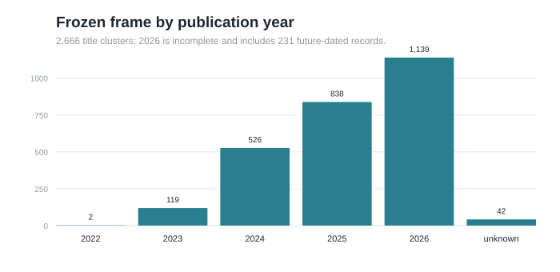
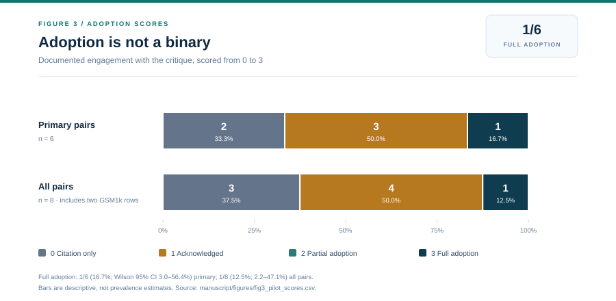

# Does Benchmark Critique Diffuse into Evaluation Practice? A Pilot-Based Study of EvalPlus and SWE-bench+ Adoption

**PILOT-BASED RESEARCH DRAFT — NOT A COMPLETED FULL-SCALE STUDY**

**Status:** Draft v0.1, 13 November 2026  
**Author:** Syed Abdul Aman (Independent Researcher)  
**Target venue:** *Empirical Software Engineering* (primary); *Data-centric Machine Learning Research* (alternative)  
**Evidence base:** frozen citation frame of 2,666 title clusters plus a purposive 29-paper pilot (27 accessible, 12 coded, 8 eligible for all pairs, 6 eligible for the two primary pairs)

> **Read this first.** This manuscript reports a pilot, not a population study. The pilot was purposive, the eligible samples are six and eight papers, and the reliability statistics are LLM–LLM agreement rather than human inter-rater reliability. The paper does **not** estimate the prevalence of adoption in the 2,666-paper frame, does **not** establish causal diffusion, and is **not** submission-ready. It is a complete, honest first draft of the argument, instrument, and pilot evidence, with the full-scale study specified but not executed.

---

## Abstract

Benchmark critiques identify concrete defects in widely used evaluations and release remediations, but citation counts do not show whether citing papers change their evaluation practice. This pilot-based study asks what proportion of papers citing a benchmark critique document adopting its recommended benchmark artifact or protocol in their own primary evaluation. The primary pairs are EvalPlus → HumanEval/MBPP and SWE-bench+ → SWE-bench. We combine a frozen citation frame of 2,666 title clusters with a purposive 29-paper pilot: 27 full texts were accessible, 12 papers were coded, 8 were eligible for the all-pair set, and 6 for the two primary pairs. Rubric v1.1 separates citation only (0), acknowledgment (1), partial adoption (2), and full adoption (3). One of six primary-pair papers (1/6) fully adopted the remediation (16.7%; Wilson 95% CI 3.0–56.4); the all-pair estimate was 1/8 (12.5%; 2.2–47.1). Three of six primary-pair papers independently remediated the benchmark without adopting the critique's artifact. None of the three SWE-bench+ cases adopted the 548-instance dataset. Agreement statistics are LLM–LLM only (ordinal κ = 0.78 unweighted, 0.86 linear weighted) and are not human reliability. Because the pilot is purposive and tiny, we do not estimate population prevalence or causal diffusion. The contribution is a transparent measurement instrument, boundary rules, and a pilot-based demonstration that citation, acknowledgment, and adoption are empirically distinct.

## Keywords

benchmark evaluation; benchmark critique; EvalPlus; SWE-bench+; citation diffusion; meta-research; reproducibility; code generation

---

## 1. Introduction

Progress in code-generation research is routinely measured with benchmarks that are later shown to be incomplete, contaminated, or too weak to support the claims made with them. HumanEval and MBPP use small sets of hand-written tests; stronger tests can expose incorrect programs that the original tests pass (Liu et al., 2023). SWE-bench and its variants can reward patches that exploit solution leakage or pass weak tests; filtering the instance set changes measured resolution rates substantially (Aleithan et al., 2024). These critiques are not merely complaints. They release concrete remediations: augmented test suites, filtered datasets, and strengthened evaluation protocols.

Whether a critique matters, however, is not measured by how often it is cited. A paper can cite a critique in a related-work paragraph, acknowledge that a benchmark has known problems, and then report its main result on the original benchmark unchanged. That pattern is familiar to anyone who has read evaluation sections closely, but it has not been systematically measured for code-generation benchmarks. Citation counts conflate awareness with use. They cannot distinguish a paper that cites a critique as background from a paper that adopts the critique's artifact in its primary evaluation.

This paper asks a narrow question with a deliberately strict outcome:

> Among research papers that cite a benchmark-remediation critique, what proportion document adopting the critique's recommended benchmark or protocol in their own evaluation of the criticized benchmark?

The primary benchmark pairs are EvalPlus → HumanEval/MBPP and SWE-bench+ → SWE-bench/Lite/Verified. GSM1k → GSM8K is retained only as a secondary task-fit contrast and is excluded from the primary denominator. The outcome is **documented adoption**, scored on a four-level rubric: citation only (0), acknowledgment (1), partial adoption (2), and full adoption (3). The binary primary outcome is full adoption (score 3). "Documented" is deliberate: the study measures what a paper's text, tables, and captions state, not whether the artifact was executed correctly.

The two primary pairs are useful because both critiques are public and licensed, yet their adoption costs differ. EvalPlus is a comparatively drop-in test augmentation: a lab can run HumanEval+ or MBPP+ with a public harness and report pass rates. SWE-bench+ requires a filtered 548-instance dataset, harness reconciliation, and re-running agents. If adoption is low even for a low-cost remediation, the problem is not only tooling cost. If adoption is higher for EvalPlus than for SWE-bench+, the contrast points to compatibility and integration cost as candidate explanations. The pilot cannot test those explanations causally; it can only show whether the categories are distinguishable and whether the contrast is worth a full study.

### 1.1 What this draft does and does not contain

This draft contains:

- a frozen, reproducible citation frame of 2,666 title clusters;
- a frozen rubric (v1.1) with explicit boundary rules;
- a purposive pilot of 29 papers, of which 27 were accessible and 12 were coded;
- pilot results for 8 eligible all-pair papers and 6 eligible primary-pair papers;
- a complete analysis and reproducibility package;
- a full-scale design, power rationale, and sensitivity plan that has **not** been executed.

It does not contain:

- a probability sample of the 2,666-paper frame;
- 900 retrieved and coded papers;
- human inter-rater reliability;
- an OSF registration or DOI;
- a causal identification strategy;
- verified execution of the artifacts that papers claim to use.

The draft is written so that a reader can see exactly which claims are supported by the pilot and which belong to the future full study. The pilot's value is construct validity and feasibility, not prevalence.

### 1.2 Contributions

1. **A measurement instrument.** Rubric v1.1 operationalizes documented adoption as a four-level ordinal construct and separates citation, acknowledgment, partial adoption, and full adoption. It includes boundary rules for generic contamination talk, independent remediation, derivative benchmarks, and appendix-only use.
2. **A frozen citation frame.** The frame contains 2,666 title clusters derived from 2,572 EvalPlus citation rows and 136 SWE-bench+ citation rows, with identifier and title deduplication documented and hashed.
3. **A pilot demonstration.** The pilot shows that the categories are empirically distinguishable: the 6 primary-pair papers split into 2 citation-only, 3 acknowledged, 0 partial, and 1 full adoption. It also shows that independent remediation is common enough to require separate coding.
4. **A transparent negative result about the evidence base.** The pilot does not support a prevalence claim, and the draft says so. The full-scale study is specified, but its central estimate remains unmeasured.

The contribution is therefore not "the first estimate of benchmark-critique diffusion." It is a defensible instrument and a pilot that justify, but do not replace, the full study.

### 1.3 Roadmap

Section 2 states the research questions and hypotheses. Section 3 positions the study against related work. Section 4 presents the conceptual framework. Section 5 describes the methodology. Section 6 characterizes the benchmark critiques and remediations. Section 7 documents frame construction. Section 8 describes sampling and eligibility. Section 9 presents the rubric and pilot reliability. Section 10 reports pilot results. Section 11 presents the statistical analysis and the pre-specified full-study plan. Section 12 discusses the findings. Sections 13–18 cover implications, validity, limitations, ethics, reproducibility, and conclusions. Section 19 lists references.

---

## 2. Research Questions and Hypotheses

### 2.1 Primary research question

**RQ.** Among research papers that cite a benchmark-remediation critique, what proportion document adopting the critique's recommended benchmark or protocol in their own evaluation of the criticized benchmark?

The estimand for the full study is the proportion of eligible citing papers with rubric score 3 in the frozen frame represented by the sample. The pilot reports the same quantity only as a descriptive count.

### 2.2 Secondary questions

| ID | Question | Role |
|---|---|---|
| SQ1 | What is the distribution of engagement with the critique (citation only, acknowledged, partial adoption, full adoption)? | Descriptive; tests whether the typology is usable |
| SQ2 | Does documented adoption differ between EvalPlus and SWE-bench+? | Descriptive/exploratory; the SWE-bench+ stratum is small |
| SQ3 | Is adoption more common in papers published at least 12 months after the critique, in peer-reviewed venues, or in papers with author overlap? | Exploratory |
| SQ4 | How often do citing papers perform independent remediation without adopting the critique's artifact? | Descriptive |
| SQ5 | How sensitive are estimates to access failure, self-citation, benchmark version, and the treatment of partial adoption? | Robustness |

### 2.3 Hypotheses and status

| ID | Hypothesis | Planned test | Status in this draft |
|---|---|---|---|
| H1 | Full adoption is uncommon among eligible citing papers: <25%. | One-sided exact binomial test vs 0.25; report prevalence and Wilson 95% CI. | Pre-specified; not confirmatory in the pilot |
| H2 | Full adoption is more common for EvalPlus than for SWE-bench+. | Fisher exact test and risk difference with Newcombe CI; report pair-specific estimates. | Exploratory; underpowered even in the full design |
| H3 | Most eligible citing papers are citation-only or acknowledged (score 0 or 1), not partial/full adopters. | One-sided exact binomial test vs 0.50 on the combined 0/1 proportion. | Pre-specified; not confirmatory in the pilot |
| H4 | Adoption is more common at least 12 months after critique release and in peer-reviewed venues. | Descriptive rates by year/venue; logistic trend only if counts permit. | Exploratory; not analyzed in the pilot |

H2 is deliberately labeled exploratory. The SWE-bench+ frame contains only 135 title clusters, and the pilot contains three SWE-bench+ papers. Even a census cannot support a well-powered difference test. The study can describe a contrast; it cannot confirm one. H4 cannot be analyzed in the pilot because the coded set is dominated by 2025 papers and includes only one full adopter.

### 2.4 What would count as support

For the full study, H1 would be evaluated with a pre-specified one-sided exact binomial test and, more importantly, the Wilson interval. H3 would be evaluated similarly on the combined 0/1 proportion. A statistically significant result with a tiny eligible sample would not be interpreted as strong evidence; the interval and the realized sample are the primary reporting objects. H2 and H4 are descriptive and will be reported with intervals and explicit statements about power.

For this draft, no hypothesis is declared supported or rejected. The pilot's exact-binomial diagnostics are reported in Section 11 only to document the pre-specified thresholds and to show why n=6 cannot settle them.

---

## 3. Related Work

### 3.1 Citation as a concept symbol, not a use claim

Small (1978) argued that cited documents function as concept symbols: a citation signals that a paper belongs to a conversation, not that its specific claims were implemented. That distinction is central here. A citation to EvalPlus can mean "the authors know tests are imperfect," "the authors use HumanEval+," or simply "this is the standard reference for test augmentation." Citation counts cannot tell these apart.

Diffusion-of-innovations research adds a second distinction: adoption is a process, not a binary event. Rogers (2003) describes awareness, persuasion, decision, implementation, and confirmation, and emphasizes that adopters may reinvent an innovation rather than implement it as specified. Our four-level rubric is a stripped-down observational analogue: citation (awareness), acknowledgment (persuasion/decision without implementation), partial adoption (implementation in a secondary role), and full adoption (implementation in the primary evaluation). The analogy is conceptual, not a validation of Rogers' stage model.

### 3.2 Benchmark critique, contamination, and evaluation validity

The benchmark-validity literature has documented several distinct failure modes. Dehghani et al. (2021) show that benchmark rankings are sensitive to benchmark choice and construction. Kapoor and Narayanan (2023) document leakage and reproducibility failures across machine-learning-based science, including benchmarks used to support claims. EvalPlus shows that HumanEval and MBPP tests are too weak: stronger tests reduce pass rates and expose incorrect programs (Liu et al., 2023). SWE-bench+ reports that a substantial share of successful SWE-bench patches involve solution leakage or weak tests, and that filtering changes measured resolution rates (Aleithan et al., 2024).

These critiques differ in what they recommend. Some recommend a new artifact (HumanEval+, MBPP+, the SWE-bench+ dataset); some recommend a protocol (filtering, strengthened tests); some recommend a parallel benchmark (GSM1k). Our study treats the recommendation as part of the critique's identity. Adoption means using the critique's recommended artifact or protocol, not merely agreeing that the original benchmark is flawed.

### 3.3 Benchmark quality assessment versus adoption

BetterBench assesses benchmark quality across a lifecycle and evaluates a set of AI benchmarks against best-practice criteria (Reuel et al., 2024). That work answers: how good is this benchmark? Our question is different: given a critique that identifies a defect and releases a remediation, do later papers use the remediation? A benchmark can score well on a quality framework and still fail to diffuse; a critique can be methodologically strong and still be cited without being used. BetterBench and related quality frameworks are therefore complements, not competitors.

### 3.4 Closest prior work

The closest prior work is Merzah's (2026) replication materials for "Cited but Not Used: Documented Adoption and Data Accessibility in 40 Non-English NLP Benchmarks." Those materials study 40 non-English NLP benchmarks, 487 citation records, accessibility and licensing, and include coding and reliability instruments. They are unpublished replication materials, not a peer-reviewed paper, and they focus on a different domain and a different outcome. Our study differs in domain (code-generation benchmarks), design (a citation-frame audit of citing works), outcome (an ordinal adoption rubric with evidence quotes and adoption locus), and contrast (a low-cost test augmentation versus a high-cost dataset filtering).

We did not locate a published study that estimates documented adoption of EvalPlus or SWE-bench+ among their citing papers. That is a statement about our search, not a priority claim. The relevant searches, dates, and links are recorded in `verification/references.md` and `verification/source_verification_log.md`. A systematic novelty search should be repeated before submission.

### 3.5 Original benchmarks and remediations

HumanEval (Chen et al., 2021) and MBPP (Austin et al., 2021) are function-level code-generation benchmarks with unit tests. SWE-bench (Jimenez et al., 2023) evaluates repository-level issue resolution. SWE-bench Lite and SWE-bench Verified are variants intended to reduce evaluation cost or improve instance quality; the SWE-bench+ critique states that the same leakage and weak-test issues exist in Lite and Verified (Aleithan et al., 2024; OpenAI, 2024). EvalPlus releases HumanEval+ and MBPP+ with augmented tests and a public harness (Liu et al., 2023). SWE-bench+ releases a 548-instance curated dataset on Zenodo under CC BY 4.0 (Aleithan et al., 2024; SWE-bench+ dataset, 2024). GSM1k is a parallel arithmetic benchmark designed to mirror GSM8K's style and complexity (Zhang et al., 2024); its dataset card leaves the license field blank, which is one reason it is secondary only.

### 3.6 What is new here

The new element is not the observation that some papers cite without using. It is the combination of:

- a citation-frame design that starts from all citing works rather than from a hand-picked benchmark sample;
- an ordinal adoption rubric with explicit boundary rules and verbatim evidence;
- a comparative contrast between a low-cost test augmentation and a high-cost dataset remediation;
- a frozen, reproducible frame and an open coding instrument.

The pilot tests whether that combination is workable. It does not establish that the resulting estimate is precise or generalizable.

---

## 4. Conceptual Framework

### 4.1 The adoption ladder

We treat documented adoption as a four-level ordinal construct:

| Level | Label | What is present | What is absent |
|---:|---|---|---|
| 0 | Citation only | A bibliographic citation; the criticized benchmark is used unchanged | Any specific discussion of the critique's finding or recommendation |
| 1 | Acknowledged | A specific statement of the critique's finding | Any use of the recommended artifact or protocol |
| 2 | Partial adoption | At least one recommended practice, but not for the main evaluation | The core artifact/protocol supporting a main claim |
| 3 | Full adoption | The core artifact/protocol supports at least one main table, figure, or claim | — |

The levels are ordered by proximity to the critique's recommended practice, not by research quality. A paper can be excellent and still score 0 if it cites the critique only as background. A paper can score 3 while implementing the artifact incorrectly; execution fidelity is a separate construct.

### 4.2 Candidate mechanisms

The framework treats four mechanisms as explanations to be examined, not as tested causal pathways in the pilot:

1. **Artifact availability.** A public, licensed, versioned artifact lowers the cost of adoption. Both EvalPlus and SWE-bench+ satisfy this condition, so availability alone cannot explain a difference between them.
2. **Compatibility.** A remediation that fits an existing harness is easier to adopt than one that requires changing instance sets, test harnesses, and agent runs. EvalPlus is closer to a drop-in test suite; SWE-bench+ is closer to a dataset-level re-evaluation.
3. **Implementation complexity.** Even a compatible artifact requires engineering time. A lab under deadline pressure may cite the critique and keep the original benchmark.
4. **Time since critique.** Adoption may lag publication because papers in progress use the benchmark version available when the work began. A citation in 2024 may reflect a evaluation designed before the remediation existed.

Two adjacent outcomes complicate the ladder:

- **Independent remediation.** A paper may build its own stronger tests or filtering protocol without using the critique's artifact. This is good practice but not diffusion of the critique's remedy. The rubric codes it separately and does not award score 2 or 3 for it.
- **Derivative benchmark use.** A paper may evaluate SWE-bench Pro or another derivative instead of SWE-bench/Lite/Verified. That is not evidence about the criticized benchmark and is ineligible, not a low score.

### 4.3 Observational boundary

The framework is observational. A citation and a documented artifact use can co-occur because the authors were persuaded by the critique, because the artifact is the default in their lab, because a reviewer asked for it, or because the paper was written after the artifact became standard. The study can describe the joint distribution; it cannot identify the reason. The discussion therefore uses mechanism language ("consistent with", "may reflect") rather than causal language.

---

## 5. Methodology

### 5.1 Design overview

The project has three components:

1. **Frame construction.** A frozen citation frame of works citing EvalPlus or SWE-bench+, retrieved from the Semantic Scholar Graph API on 13 November 2026.
2. **Pilot.** A purposive 29-paper access frame, 27 accessible full texts, 12 coded papers, and 8 eligible all-pair / 6 eligible primary-pair papers. The pilot tests the rubric, access, and coding workflow.
3. **Full-study plan.** A stratified design of 900 invited papers (135 SWE-bench+ census + 765 EvalPlus-only sample) with a stop rule and a pre-specified analysis plan. The full study has **not** been executed.

The unit of analysis is a title-level citing work × critique. A paper that cites both critiques gets two rows. A paper that evaluates multiple criticized benchmarks gets one score per critique, based on the highest-adoption use that supports a main claim; benchmark-level details are recorded in secondary fields.

### 5.2 Data sources

- Semantic Scholar Graph API for citation records and metadata.
- arXiv for preprints and full texts where available.
- Publisher pages, DOIs, and author copies for published versions.
- GitHub and Zenodo for artifact metadata and licenses.
- Official benchmark repositories for version information.

The pilot used the retrieved full texts and recorded evidence quotes. It did not use a commercial full-text database, and it did not bypass paywalls. The frame is a Semantic Scholar snapshot; it is not a census of all literature.

### 5.3 Eligibility

A paper is eligible only if all three conditions hold:

- **E1:** it reports empirical evaluation results on the criticized benchmark (HumanEval, MBPP, SWE-bench, SWE-bench Lite, or SWE-bench Verified);
- **E2:** it contains a bibliographic citation to the critique;
- **E3:** a full text is available in English with enough methods/results detail to code.

Failure codes are `INELIGIBLE_NO_EVAL`, `INELIGIBLE_NO_CITATION`, `UNCODABLE_ACCESS`, and `UNCODABLE_LANGUAGE`. Eligibility is decided before scoring. An ineligible paper receives no 0–3 score; the placeholder zero in the source coding table is not an outcome.

### 5.4 Coding procedure

The coder reads the title and abstract, retrieves the full text, confirms E1–E3, searches for the critique's author names, title, arXiv ID, artifact name, and benchmark names, and reads the citation context plus the methods and main results. The coder assigns a score and secondary fields, records a verbatim evidence quote of at most 60 words and its section/table, and flags ambiguity for adjudication. Scores of 1 or higher cannot be assigned from an abstract alone.

The pilot coding table records the paper key, title, venue, year, critique, eligibility, ineligibility reason, score, engagement, independent remediation, evidence quote, and notes. It does not record page numbers for every quote; the full study's coding form requires a section or table locator.

### 5.5 Reliability

The full-study plan requires a human second coder for 20% of eligible papers, stratified by critique and score band, with percent agreement and Cohen's κ for eligibility, unweighted and linear-weighted κ for the ordinal score, and bootstrap confidence intervals. The threshold is weighted κ ≥ 0.60 for the main analysis; 0.40–0.59 requires a limitation; below 0.40 triggers retraining and recoding.

The pilot did **not** meet this standard. Its two coding passes were LLM annotations with fresh context. The agreement statistics (eligibility 12/12; ordinal 7/8; unweighted κ = 0.78; linear-weighted κ = 0.86) are LLM–LLM agreement. They are useful for debugging the rubric, not for a human reliability claim. The exact model identifier, prompt, and temperature were not preserved in the pilot record; this is a documentation gap that the full study must fix.

### 5.6 Analysis

The pilot analysis reports counts, score distributions, Wilson 95% intervals, pair-specific descriptive estimates, engagement, and independent remediation. It computes exact-binomial diagnostics for the pre-specified H1/H3 thresholds but does not use them for confirmatory inference. The full-study analysis adds design weights, a stratified bootstrap, sensitivity analyses, and access-bias bounds. Section 11 gives the details.

### 5.7 Deviations and study status

The full registered design is 900 invited papers (135 SWE-bench+ census + 765 EvalPlus-only). It was **not** executed. A 335-record feasibility cohort (135 SWE-bench+ census + 200 EvalPlus-only, seed `20261113`, frame SHA-256 `6a0a374b…`) was drawn to test retrieval, but retrieval was halted before completion and no feasibility-cohort records were coded. The cohort is a documented deviation from the registered design, not a substitute sample, and it contributes no results to this draft.

The pilot's 29-paper frame was purposive. It was assembled to cover different benchmarks and likely adoption levels, not to represent the 2,666-paper frame. Its 93.1% access rate is therefore a feasibility signal, not an estimate of general access.

---

## 6. Benchmark Critique and Remediation Characteristics

### 6.1 EvalPlus → HumanEval/MBPP

EvalPlus (Liu et al., 2023) argues that HumanEval and MBPP tests are insufficiently rigorous: programs can pass the original tests while being incorrect. It releases HumanEval+ and MBPP+ with augmented tests and a public harness. The verified artifact facts are: Apache-2.0 license; 80× more tests for HumanEval+; 35× more tests for MBPP+; MBPP+ contains 378 tasks after v0.2.0; the paper reports that HumanEval+ catches previously undetected wrong code and reduces pass@k by up to 19.3–28.9% (Liu et al., 2023; see `verification/source_verification_log.md`).

For a citing paper, adoption can be relatively low-friction: run the public harness on HumanEval+/MBPP+ and report pass rates. That does not make adoption automatic — a lab may have an existing pipeline, may compare to prior numbers on the original benchmark, or may use the augmented tests only as a robustness check — but the artifact is compatible with the original task format.

### 6.2 SWE-bench+ → SWE-bench/Lite/Verified

SWE-bench+ (Aleithan et al., 2024) argues that SWE-bench evaluation is affected by solution leakage and weak tests. The critique reports that 32.67% of successful patches involve solution leakage and 31.08% of passed patches are suspicious due to weak tests; after filtering, the resolution rate falls from 12.47% to 3.97%. It releases a 548-instance curated dataset on Zenodo under CC BY 4.0. No peer-reviewed venue record for the critique was located in the checks performed; it is described as an arXiv preprint.

Adoption requires more than adding a test file: the paper must use a different instance set, reconcile the harness, and re-run agents. A lab may reasonably decide that the original SWE-bench number is the comparable one, or may build its own filtering protocol. Those decisions are exactly what the rubric is designed to distinguish: acknowledgment (1), independent remediation (1 with `independent_remediation=yes`), partial adoption (2), or full adoption (3).

### 6.3 GSM1k → GSM8K (secondary only)

GSM1k (Zhang et al., 2024) is a parallel arithmetic benchmark designed to mirror GSM8K's style and complexity; the paper reports accuracy drops of up to 8% on GSM1k. The Hugging Face dataset has 1,205 rows and a blank license field. GSM1k is excluded from the primary denominator for four reasons: task fit (it is not a drop-in replacement for GSM8K), availability timing (the full dataset appeared in 2025, after many frame papers were written), license ambiguity, and comparability (the construct is a contamination-controlled parallel benchmark, not a direct remediation of GSM8K). It is retained only as a secondary contrast, and its pilot rows are never pooled into the primary estimate.

### 6.4 Why the contrast is informative

Both primary critiques are public and licensed, so adoption is not blocked by paywalls or missing artifacts. Their remediation costs differ. If EvalPlus adoption is high and SWE-bench+ adoption is low, the difference is consistent with compatibility and integration cost. If both are low, the problem is broader than tooling. If both are high, citation-based concerns about "critique without practice" are less pressing, at least for these pairs. The pilot has three papers per pair, so it can illustrate these possibilities but cannot choose among them.

**Table 1.** Benchmark pairs and remediation characteristics (`manuscript/tables/table1_benchmark_pairs.md`).

| Pair | Critique | Criticized benchmark | Recommended practice | Artifact status | Cost | Role |
|---|---|---|---|---|---|---|
| P1 | EvalPlus (Liu et al., 2023) | HumanEval; MBPP | HumanEval+ / MBPP+ augmented tests as the primary evaluation | Public GitHub harness; Apache-2.0; 80× tests for HumanEval+, 35× for MBPP+, 378 MBPP+ tasks | Low: drop-in test suite and harness | Primary |
| P2 | SWE-bench+ (Aleithan et al., 2024) | SWE-bench; Lite; Verified | 548-instance curated dataset and/or strengthened-test protocol as the primary evaluation | Public Zenodo dataset; CC BY 4.0; 548 instances | High: filtered instances, harness reconciliation, agent re-runs | Primary |
| S1 | GSM1k (Zhang et al., 2024) | GSM8K | GSM1k or a fully equivalent contamination-controlled replication | Public Hugging Face dataset; 1,205 rows; license field blank | Medium: parallel benchmark, not a drop-in replacement | Secondary only; excluded from primary denominator |

*Cost is an analytic characterization, not a measured implementation time. Artifact facts are verified in `verification/source_verification_log.md`.*

---

## 7. Citation-Frame Construction

### 7.1 Source and retrieval

The frame is a snapshot of works citing the two critique papers, retrieved from the Semantic Scholar Graph API on 13 November 2026. The retrieval returned 2,572 EvalPlus citation rows and 136 SWE-bench+ citation rows. Semantic Scholar reported 2,573 EvalPlus citations; one row was not returned. The raw sum is 2,708 rows.

### 7.2 Deduplication

Two deduplication steps were applied:

1. **Identifier union-find.** Records were merged if they shared a DOI (lowercased), arXiv ID, DBLP key, CorpusId, or Semantic Scholar paperId, with transitive closure. This produced the identifier-deduplicated union of 2,684 records. That number is an intermediate count, not the analysis frame.
2. **Title clustering.** Normalized titles were produced by lowercasing, replacing non-alphanumeric characters with spaces, and collapsing whitespace. Identical normalized titles were merged into one cluster. A representative record was chosen by preferring a DOI, then an arXiv ID, then the earliest year, then paperId. All source labels were unioned into the cluster.

Title clustering produced 2,666 clusters. Fourteen multi-variant clusters accounted for 18 extra rows. The final frame has 135 clusters in the SWE-bench+ census stratum (112 SWE-only + 23 citing both critiques) and 2,531 in the EvalPlus-only stratum. The 23 both-critique clusters are assigned to the SWE-bench+ census so that the small stratum is a complete census.

### 7.3 Frame profile

| Quantity | Count |
|---|---:|
| Raw EvalPlus citation rows | 2,572 |
| Raw SWE-bench+ citation rows | 136 |
| Raw sum | 2,708 |
| Identifier-deduplicated union | 2,684 |
| Title-deduplicated analysis frame | **2,666** |
| SWE-bench+ census stratum | 135 |
| EvalPlus-only sample stratum | 2,531 |
| Clusters citing both critiques | 23 |

The year distribution is 2022: 2; 2023: 119; 2024: 526; 2025: 838; 2026: 1,139; unknown: 42. DOI coverage is 2,313 clusters, arXiv coverage is 2,028, DBLP coverage is 2,129, and 42 clusters have none of DOI/arXiv/DBLP. Two hundred twenty-five clusters have no publication date, 231 have a publication date after 30 September 2026 (likely forthcoming issue dates), and 14 clusters have multiple title variants. These are reported, not silently dropped.

**Table 2.** Frozen citation-frame profile (`manuscript/tables/table2_frame_profile.md`).

| Quantity | Count | Note |
|---|---:|---|
| Raw EvalPlus citation rows | 2,572 | Semantic Scholar reports 2,573; one row not returned. |
| Raw SWE-bench+ citation rows | 136 | Semantic Scholar reports 136. |
| Identifier-deduplicated union | 2,684 | Intermediate count; not the analysis frame. |
| Title-deduplicated clusters | **2,666** | Frozen analysis frame. |
| SWE-bench+ census stratum | 135 | Includes 23 clusters citing both critiques. |
| EvalPlus-only sample stratum | 2,531 | Sampled in the planned main design. |
| Clusters citing both critiques | 23 | Assigned to the SWE-bench+ census. |

**Frame hashes.** Source `citation_frame.json`: `46a58fe017577d9e15c22e6bef198fdff526b511ff7897519b6a0e91542cdd72`. Analysis CSV `citation_frame_2666.csv`: `6a0a374ba6120b244418e887a76a83d6bfb8a95dd61cfc822cf349ac7043d30c`.



**Figure 1.** Frozen frame by publication year. The 2026 bar is incomplete and includes 231 records with future-dated publication metadata. Source data: `manuscript/figures/fig1_frame_years.csv`.

### 7.4 What the frame is and is not

The frame is a Semantic Scholar-indexed citation snapshot, not a census of all papers that cite either critique. It misses non-indexed venues, papers with incomplete metadata, and citations added after 13 November 2026. The 2026 portion is incomplete. Title clustering merges preprints and published versions with identical normalized titles, but it can also merge distinct works with identical titles; the 14 multi-variant clusters require manual review before the full study.

The frame is frozen. A post-freeze citation refresh may be reported as a sensitivity analysis but cannot change the sampling frame. This prevents denominator drift and selective inclusion.

### 7.5 PRISMA-informed flow

The pilot reports a PRISMA-informed flow (Page et al., 2021): frame, access, coding, eligibility, and inclusion. It is not a full systematic review, and the flow is used to make exclusion and access decisions auditable rather than to claim PRISMA compliance.

---

## 8. Sampling and Eligibility

### 8.1 Planned full-study sampling design

The full study is designed as a stratified random sample with a census of the small SWE-bench+ stratum:

| Stratum | Frame N | Planned sample | Design weight |
|---|---:|---:|---:|
| SWE-bench+ census (includes 23 both-critique clusters) | 135 | 135 (census) | 1.000 |
| EvalPlus-only | 2,531 | 765 (random) | 3.308 |
| **Total invited** | **2,666** | **900** | — |

The EvalPlus-only sample is allocated proportionally by publication year (2022 collapsed into 2023; minimum 10 per non-empty stratum where possible), then sampled randomly within year. A fixed seed is to be committed at registration. The planning value is p = 0.125, with 80% access and 18% eligibility; 900 invited would yield about 130 eligible papers and a Wilson 95% CI of roughly 7.7–19.1% (half-width 5.7 percentage points). These are planning assumptions, not observed values.

The stop rule is to sample in blocks: the initial target is 900 invited; if fewer than 120 eligible papers are found, add blocks of 100 EvalPlus-only records up to a hard cap of 1,200 invited; stop as soon as 120 eligible papers are reached. If the cap is reached with fewer than 120 eligible, the realized count is reported and no further extension occurs without a protocol amendment.

**This design was not executed.** The number 900 is a plan, not a result.

### 8.2 Pilot sampling

The pilot used a purposive 29-paper access frame assembled from papers citing EvalPlus, SWE-bench+, or GSM1k. The papers were selected to cover different benchmarks and likely adoption levels, not to represent the frame. Twenty-seven full texts were accessible (93.1%), 12 papers were coded, 8 were eligible for the all-pair set, and 6 were eligible for the two primary pairs. Four of the 12 coded papers were ineligible. Of the 27 accessible papers, 15 were not coded after category saturation; the two inaccessible papers were not coded.

**Table 3.** Pilot flow (`manuscript/tables/table3_pilot_flow.md`).

| Stage | n | Note |
|---|---:|---|
| Purposive access frame | 29 | Selected for construct coverage, not randomly. |
| Full text accessible | 27 | 93.1% of the purposive frame; not generalizable. |
| Coded with rubric | 12 | Evidence quotes recorded. |
| Eligible, all pairs | 8 | Includes two GSM1k secondary rows. |
| Eligible, primary pairs | 6 | EvalPlus + SWE-bench+ only. |
| Ineligible | 4 | Mostly no evaluation of the criticized benchmark. |


**Figure 2.** Pilot flow from the 29-paper purposive frame to the 6 primary-pair eligible papers. The 93.1% access rate applies only to this purposive frame. Source data: `manuscript/figures/fig2_pilot_flow.csv`.

### 8.3 Eligibility criteria

Eligibility is decided before scoring:

- **E1:** the paper reports empirical evaluation results on the criticized benchmark (HumanEval, MBPP, SWE-bench, SWE-bench Lite, or SWE-bench Verified);
- **E2:** the paper contains a bibliographic citation to the critique paper or official artifact;
- **E3:** a full text is available in English with enough methods/results detail to code.

A paper evaluating only a derivative benchmark (for example, SWE-bench Pro or CWEval) but not the criticized benchmark is ineligible. A paper evaluating both the original and a derivative is eligible; the original is coded. A paper that constructs a new benchmark by sampling problems from HumanEval+ or MBPP+ is eligible only if it reports evaluation results on those sampled problems; this is recorded as `derived_benchmark=yes`.

### 8.4 Pilot exclusions

The four ineligible pilot papers illustrate the boundary rules:

- `swebenchpro` evaluates SWE-bench Pro, a derivative, not SWE-bench/Lite/Verified.
- `cweval` evaluates CWEval and cites EvalPlus only as future work; it does not evaluate HumanEval/MBPP.
- `hafix` cites Aleithan et al. in a generic bug-fixing list and does not evaluate SWE-bench/Lite/Verified.
- `demystifying` cites Zhang et al. in a generic claim and does not evaluate GSM8K.

Ineligible papers receive no 0–3 score. Their blank score fields in the pilot coding table are not outcomes.

### 8.5 Access and the feasibility deviation

The pilot's 93.1% access rate is a feasibility signal, not an estimate for the 2,666-paper frame. A 335-record feasibility cohort was drawn later (135 SWE-bench+ census + 200 EvalPlus-only, seed `20261113`, frame SHA-256 `6a0a374b…`) to test retrieval on a larger set. Retrieval was halted before completion and no cohort records were coded. The cohort is a documented deviation from the registered 900-paper design and contributes no results to this draft. The partial retrieval produced no coding table, no adoption scores, and no denominator for inference.

The full study must run the protocol's 50-record access pretest before committing to 900 invitations. If access is 70% or higher, proceed; if 50–70%, add interlibrary loan and document the shortfall; if below 50%, restrict the primary frame to open-access records and report the restriction, or pause.

---

## 9. Coding Rubric and Reliability

### 9.1 Construct

**Documented adoption** is the extent to which a citing paper's own evaluation of the criticized benchmark uses the critique's recommended artifact or protocol, as stated in the paper's text, tables, or captions. It is not citation frequency, agreement with the critique, general evaluation quality, independent remediation, or verified execution of the artifact.

### 9.2 Ordinal scale

| Score | Label | Definition | Typical evidence |
|---:|---|---|---|
| **0** | Citation only | The critique appears in the reference list, but the body does not discuss its specific finding or recommendation; the criticized benchmark is used unchanged. A generic mention of "contamination" or "leakage" in a citation cluster is 0. | Reference entry; generic related-work sentence with no specific claim. |
| **1** | Acknowledged | The body mentions the critique's specific finding (test insufficiency, solution leakage, contamination) but the evaluation is unchanged: original instances/tests, no filtering, no augmented tests, no contamination-controlled replication. | "Liu et al. report gaps in HumanEval's tests; we use the original HumanEval." |
| **2** | Partial adoption | At least one recommended practice is applied to the criticized benchmark, but not the core remediated artifact/protocol for the main results. Examples: HumanEval+ only in an appendix or robustness check while the main table uses HumanEval; SWE-bench+ filtering applied to a subset or a secondary analysis. | Main table uses HumanEval; appendix reports HumanEval+. |
| **3** | Full adoption | The core remediated artifact/protocol is used for the paper's primary evaluation of the criticized benchmark, with at least one reported result and the critique cited as the basis. | Main table uses HumanEval+/MBPP+; main SWE-bench table uses the 548-instance SWE-bench+ set or its protocol. |

The binary primary outcome is full adoption (score 3). Scores 0–2 are non-adoption for the primary estimate. Partial adoption is reported separately and tested as a sensitivity analysis (2+3 vs 0+1).

### 9.3 Boundary rules

1. **Citation is not adoption.** A reference-list entry alone is 0.
2. **Generic contamination talk is not acknowledgment.** If the paper says contamination is a concern and cites the critique in a cluster, but never states the critique's specific finding or implication for its own evaluation, score 0.
3. **Acknowledgment requires specificity.** A sentence that names the critique's finding and leaves the evaluation unchanged is 1.
4. **Independent remediation is not adoption.** An independently designed stronger test suite is not the critique's artifact; score 1 if the finding is discussed and set `independent_remediation=yes`.
5. **Full requires the main evaluation.** If the augmented/filtered benchmark is only a secondary check, score 2. If it supports at least one main claim/table/figure, score 3.
6. **Both original and augmented as co-primary.** Score 3 if the augmented result supports at least one main claim; otherwise 2.
7. **Derivative-only papers are ineligible.** SWE-bench Pro, CWEval, and other derivatives do not count as evaluating SWE-bench/Lite/Verified.
8. **Benchmark version is recorded, not scored.** Do not change the score solely because the version differs, unless the paper explicitly uses a different construct.
9. **Code inspection can corroborate but not upgrade.** The construct is documented adoption.
10. **Self-citation is coded normally** and flagged for a sensitivity analysis.
11. **Unresolved ambiguity** receives `confidence=low`, goes to adjudication, and uses the conservative (lower) score if still unresolved.

The full rubric, worked cases, and coding form are in `rubric_v1.1.md`.

### 9.4 Evidence standard

Each score of 1 or higher requires a verbatim evidence quote of at most 60 words and a section or table locator. Scores cannot be assigned from an abstract alone. A generic citation cluster is not evidence of acknowledgment. The pilot table records short quotes for most cases; it does not record page numbers for every quote, which is a limitation to fix in the full study.

### 9.5 Pilot reliability

| Check | Result |
|---|---|
| Eligibility agreement | 12/12 (100%) |
| Eligibility κ | 1.00 by convention (no variance) |
| Ordinal agreement | 7/8 (87.5%) |
| Ordinal unweighted κ | 0.78 |
| Ordinal linear-weighted κ | 0.86 |
| Disagreement | `promptcot`: first pass 0; second pass proposed 1; adjudicated 0 |

**Critical caveat.** Both passes were LLM annotations with fresh context. These are **not** human inter-rater reliability statistics. No human second coder coded the pilot. The exact model identifier, prompt, temperature, and date were not preserved; the full study must log them. The primary-pair subset had no ordinal disagreements (6/6), but n=6 is too small to estimate reliability, and a 6/6 agreement rate must not be reported as a reliability result.

### 9.6 Changes from rubric v1.0

Rubric v1.1 made four substantive changes:

1. **GSM1k became secondary only.** It is excluded from the primary denominator for task fit, release timing, license ambiguity, and non-substitutability.
2. **Generic contamination/leakage mentions became score 0.** Acknowledgment requires the critique's specific finding. This resolved the `promptcot` disagreement toward 0.
3. **Derivative-only papers became ineligible**, not score 0. SWE-bench Pro and CWEval do not evaluate the criticized benchmark.
4. **Full adoption requires a main claim.** Appendix-only or robustness-only use is score 2. `whatswrong` remains 3 because HumanEval+ and MBPP+ are its main benchmarks.

These changes were made before the pilot results were interpreted and are documented in `pilot/rubric_v1_to_v1.1.md`.

---

## 10. Results

### 10.1 Access and coding

The pilot's 29-paper purposive frame yielded 27 accessible full texts (93.1%). Twelve papers were coded, 8 were eligible for the all-pair set, and 6 were eligible for the primary pairs. The four ineligible papers were excluded for no evaluation of the criticized benchmark; none was excluded for lacking a citation. The two inaccessible papers were not coded and are not counted as non-adopters.

### 10.2 Primary-pair distribution

Among the 6 primary-pair papers:

| Score | Label | n | Share |
|---:|---|---:|---:|
| 0 | Citation only | 2 | 33.3% |
| 1 | Acknowledged | 3 | 50.0% |
| 2 | Partial adoption | 0 | 0.0% |
| 3 | Full adoption | 1 | 16.7% |

**Table 4.** Pilot adoption-score distribution (`manuscript/tables/table4_pilot_scores.md`).

The single full adoption is `whatswrong`, which uses HumanEval+ and MBPP+ as main benchmarks and reports pass rates on 164 HumanEval+ samples and 399 MBPP+ samples. The recorded evidence is: "we selected three widely used benchmarks, HumanEval+ [31], MBPP+ [30] and APPS+ [15] ... Our benchmark includes 164 samples from HumanEval+, 399 samples from MBPP+". This is full adoption under the rubric because the augmented tests support the paper's primary evaluation, not an appendix.

The three acknowledged papers are `utboost`, `schrodinger`, and `calibration`. `utboost` discusses the critique's incorrect-patch finding but proposes UTBoost rather than using the SWE-bench+ dataset: "we can not directly apply EvalPlus to add test cases for SWE-Bench". `schrodinger` cites SWE-bench+ as an enhancement but uses its own repository transformations on SWE-bench Verified. `calibration` states that "Liu et al. [13] report gaps in the test sets of HumanEval" but evaluates the original HumanEval. None of these is partial adoption under v1.1: they acknowledge the critique without using its recommended artifact for a main result.

The two citation-only papers are `reagent` and `correctness_internal`. `reagent` cites Aleithan et al. only in the reference list and runs its own leakage analysis; `correctness_internal` cites Liu et al. only in the reference list and evaluates original HumanEval/MBPP without discussing the test-insufficiency finding. Independent remediation is coded separately and does not raise the score.



**Figure 3.** Pilot adoption-score distribution for the primary pairs (n=6) and all pairs (n=8). Counts are tiny; bars are descriptive, not prevalence estimates. Source data: `manuscript/figures/fig3_pilot_scores.csv`.

### 10.3 All-pair distribution

The all-pair set adds the two GSM1k secondary cases. Its distribution is 3 citation-only, 4 acknowledged, 0 partial, and 1 full. The full adopter is still `whatswrong` (EvalPlus). `understand_translate` scores 1 for GSM1k: it cites Zhang et al. in a generic contamination sentence and runs its own KSM check, not GSM1k, while evaluating GSM8K/translated data unchanged; it is flagged as independent remediation. `promptcot` scores 0 under the generic-cluster rule: it cites Zhang et al. in a generic memorization cluster and evaluates GSM8K unchanged. The second pass proposed 1 for `promptcot`; adjudication chose 0 under v1.1.

The all-pair full-adoption proportion is 1/8 = 12.5% (Wilson 95% CI 2.2–47.1%). This is not the primary estimate. It is reported because the protocol uses 12.5% as a conservative planning value and because the GSM1k cases test the rubric's task-fit boundary.

### 10.4 Pair-specific descriptive results

| Critique | Eligible n | Full (3) | Full % | Wilson 95% CI | Acknowledged or better | Independent remediation |
|---|---:|---:|---:|---|---:|---:|
| EvalPlus | 3 | 1 | 33.3% | 6.1–79.2% | 2 | 0 |
| SWE-bench+ | 3 | 0 | 0.0% | 0.0–56.1% | 2 | 3 |
| GSM1k (secondary) | 2 | 0 | 0.0% | 0.0–65.8% | 1 | 1 |

**Table 5.** Pair-specific pilot results (`manuscript/tables/table5_pair_specific.md`).

The EvalPlus/SWE-bench+ contrast is descriptively suggestive but uninformative: each cell has three papers, the intervals overlap almost completely, and the SWE-bench+ estimate is 0/3. No difference test is reported. The SWE-bench+ cases are all acknowledged or citation-only; all three are flagged as independent remediation (`utboost`, `schrodinger`, `reagent`). That pattern is consistent with a compatibility/integration-cost explanation, but it is also consistent with the small and selected nature of the pilot.

### 10.5 Engagement and independent remediation

Engagement is coded 0 = reference only, 1 = brief mention, 2 = substantive discussion. For the primary pairs, the distribution is 2 reference-only, 1 brief, and 3 substantive. For all pairs, it is 3 reference-only, 2 brief, and 3 substantive. Independent remediation is present in 3/6 primary-pair papers (50.0%) and 4/8 all-pair papers (50.0%). In other words, half of the eligible pilot papers did something to strengthen evaluation without adopting the critique's artifact. This is the main reason the rubric separates "good evaluation practice" from "diffusion of the critique's remedy."

### 10.6 Boundary cases

**Table 6.** Coded pilot cases and boundary decisions (`manuscript/tables/table6_coded_cases.md`).

| Paper key | Critique | Eligible | Score | Independent remediation | Boundary decision |
|---|---|---|---:|---|---|
| `whatswrong` | EvalPlus | yes | 3 | no | HumanEval+/MBPP+ are main benchmarks; full adoption. |
| `utboost` | SWE-bench+ | yes | 1 | yes | Discusses incorrect patches; proposes UTBoost, not SWE-bench+. |
| `schrodinger` | SWE-bench+ | yes | 1 | yes | Cites SWE-bench+ as enhancement; uses own transformations. |
| `calibration` | EvalPlus | yes | 1 | no | Specific test-gap acknowledgment; original HumanEval. |
| `reagent` | SWE-bench+ | yes | 0 | yes | Reference only; independent leakage analysis. |
| `correctness_internal` | EvalPlus | yes | 0 | no | Reference only; original HumanEval/MBPP. |
| `understand_translate` | GSM1k | yes | 1 | yes | Generic contamination citation; own KSM check; secondary. |
| `promptcot` | GSM1k | yes | 0 | no | Generic memorization cluster; adjudicated 0; secondary. |
| `hafix` | SWE-bench+ | no | — | no | No evaluation of SWE-bench/Lite/Verified. |
| `swebenchpro` | SWE-bench+ | no | — | no | Evaluates derivative SWE-bench Pro only. |
| `cweval` | EvalPlus | no | — | no | Evaluates CWEval; cites EvalPlus as future work. |
| `demystifying` | GSM1k | no | — | no | No GSM8K evaluation. |

The table makes the central measurement point visible: the difference between `utboost` (score 1) and `whatswrong` (score 3) is not the quality of the paper or the seriousness of its engagement. It is whether the critique's recommended artifact supports the paper's main evaluation.

### 10.7 What the pilot found, in one paragraph

In a purposive 29-paper pilot, 12 papers were coded and 8 were eligible for the all-pair set (6 for the primary pairs). One primary-pair paper fully adopted its critique's remediation (1/6, 16.7%; Wilson 95% CI 3.0–56.4); one all-pair paper did so (1/8, 12.5%; 2.2–47.1). Acknowledgment without adoption was more common than full adoption (3/6 primary-pair, 4/8 all-pair), and independent remediation was common (3/6 primary-pair, 4/8 all-pair). The three SWE-bench+ papers did not adopt the 548-instance dataset; they acknowledged the critique or cited it only, and all three independently remediated. These counts are too small and too selectively sampled to estimate prevalence.

---

## 11. Statistical Analysis

### 11.1 Estimand and intervals

The full-study estimand is the proportion of eligible citing papers with score 3 in the frozen frame represented by the sample. The pilot reports the same quantity as a descriptive proportion with a Wilson 95% interval (Wilson, 1927). Wilson intervals are used because they behave better than Wald intervals when proportions are near 0 or 1 and when n is small.

| Quantity | k | n | Estimate | Wilson 95% CI |
|---|---:|---:|---:|---|
| Full adoption, primary pairs | 1 | 6 | 16.7% | 3.0–56.4% |
| Full adoption, all pairs | 1 | 8 | 12.5% | 2.2–47.1% |
| Acknowledged or better, primary pairs | 4 | 6 | 66.7% | 30.0–90.3% |
| Citation only, primary pairs | 2 | 6 | 33.3% | 9.7–70.0% |
| Independent remediation, primary pairs | 3 | 6 | 50.0% | 18.8–81.2% |

The interval for 1/6 spans 3.0–56.4%. That is not a precise estimate; it is a statement that the pilot is compatible with a very low or a moderately high adoption rate. The same is true of 1/8 (2.2–47.1%). Reporting a point estimate without the interval would overstate what the pilot knows.

### 11.2 Exact-binomial diagnostics

The protocol pre-specifies H1 (full adoption <25%) and H3 (most papers score 0 or 1). For transparency, the pilot computes one-sided exact-binomial diagnostics:

| Diagnostic | k/n | One-sided p | Interpretation |
|---|---:|---:|---|
| H1: full adoption <25% | 1/6 | 0.534 | Not confirmatory; n=6 cannot distinguish 16.7% from 25%. |
| H3: score 0/1 >50% | 5/6 | 0.109 | Not confirmatory; the observed 83.3% is compatible with 50% at n=6. |

These p-values are **not** used to support or reject the hypotheses. They are reported to document the pre-specified thresholds and to make clear why the pilot cannot settle them. A significant result at n=6 would not be strong evidence; a non-significant result is not evidence of no effect.

### 11.3 Pair contrast

The descriptive pair contrast is EvalPlus 1/3 (33.3%; Wilson 6.1–79.2%) versus SWE-bench+ 0/3 (0.0%; Wilson 0.0–56.1%). The observed risk difference is +33.3 percentage points, but the intervals overlap almost completely. No Fisher test is reported because the pilot is not a probability sample and the cells are too small for a meaningful test. The full study will report a Fisher exact test and a Newcombe risk-difference interval as exploratory analyses, with explicit power caveats.

### 11.4 Time-cohort and venue analyses

H4 is not analyzed. The coded pilot is dominated by 2025 papers; the one full adopter is a 2025 paper; several venue fields are unknown or unpublished. A time-cohort analysis would require a larger, dated, probability sample and a pre-specified minimum citation-to-publication window. The full study will report descriptive rates by publication year and venue, and will fit a logistic trend only if there are at least 10 events per predictor. It will not fit a multivariable model to sparse pilot data.

### 11.5 Full-study analysis plan

The full study will report:

- the realized flow: invited, accessible, eligible, coded, by stratum and year;
- pair-specific full-adoption proportions with Wilson intervals;
- a pooled design-weighted estimate using the inverse inclusion probabilities (SWE-bench+ weight 1; EvalPlus-only weight 2,531/765 = 3.308), with a stratified bootstrap interval;
- the unweighted sample proportion as a descriptive check;
- score distributions, engagement, independent remediation, and adoption locus;
- sensitivity analyses for partial-as-adoption, self-citation, 2026/future-dated records, missing DOI/arXiv, peer-reviewed-only, ≥12 months after critique release, access extreme bounds, main-results-only versus any-use, the 2,684-row identifier-deduplicated frame, and the 14 multi-variant clusters;
- access-bias comparisons on year, venue, identifier presence, and stratum;
- extreme bounds that assume all uncodable papers are non-adopters (lower) or all are adopters (upper).

The planning scenario is 900 invited, 80% access, 18% eligibility, and p = 0.125, yielding about 130 eligible papers and a Wilson interval of roughly 7.7–19.1% (half-width 5.7 percentage points). This is a design calculation, not an observed result. The stop rule and the 1,200-invitation cap are in Section 8.

### 11.6 Missing data and multiplicity

`UNCODABLE_ACCESS` and `UNCODABLE_LANGUAGE` are not eligible; they are reported in the flow and in the extreme bounds. Missing metadata are reported, not imputed for the primary analysis. Ambiguous scores go to adjudication; unresolved cases use the conservative lower score and are flagged.

H1 and H3 are the only confirmatory tests. No alpha adjustment is applied across them because there are only two and both are reported. H2 and H4 are exploratory and will be labeled as such. A non-significant H2 will not be described as evidence of no difference.

### 11.7 Software

The analysis uses Python 3.11+ and standard-library code for the pilot. Wilson intervals and exact-binomial diagnostics are implemented in `scripts/analyze_pilot.py`; the general analysis template is `scripts/analysis_template.py`. The pilot outputs are in `analysis/pilot_results.json` and `analysis/pilot_results.md`. The full study may use pandas, NumPy, SciPy, and statsmodels; these are optional for the pilot.

---

## 12. Discussion

### 12.1 The main pattern

The pilot's central pattern is that citation, acknowledgment, and adoption are distinct. Among six primary-pair papers, two cited the critique only, three acknowledged its specific finding without changing their evaluation, and one used the recommended artifact in its main evaluation. If the pilot had counted acknowledgment or better as adoption, it would have reported 4/6 (66.7%) rather than 1/6 (16.7%). That difference is the measurement contribution: a citation audit that stops at acknowledgment counts will overstate practice change.

The pattern is not a prevalence estimate. The pilot was purposive, and the eligible set is six papers. A reader should treat 1/6 as a demonstration that full adoption exists and is distinguishable, not as an estimate that 16.7% of citing papers adopt.

### 12.2 Why full adoption was rare in the pilot

The pilot is consistent with several explanations, none of which it can test:

- **Compatibility and integration cost.** EvalPlus is closer to a drop-in test suite; SWE-bench+ requires a different instance set and harness. The one full adopter is an EvalPlus paper; the three SWE-bench+ papers acknowledged or cited the critique but used their own remediation. This is the pattern the cost contrast predicts, but it is also what a small selected sample could produce by chance.
- **Time since critique.** The pilot is dominated by 2025 papers. Some may have been designed before the remediation was available or before it became practical to adopt. The full study's time-cohort analysis is needed to examine this.
- **Comparability pressure.** A lab may keep the original benchmark because prior work reports numbers on it. Switching to a remediated benchmark can make its results incomparable with the literature it is trying to beat.
- **Acknowledgment as a low-cost signal.** Citing a critique and noting its finding is cheap; changing an evaluation pipeline is not. The rubric separates these costs.
- **Independent remediation as a substitute.** `utboost`, `schrodinger`, and `reagent` all did something about the problem without adopting SWE-bench+. If independent remediation is common, a citation audit that treats non-adoption as indifference will misdescribe the field.

The pilot cannot choose among these explanations. The discussion uses them as hypotheses for the full study, not as findings.

### 12.3 The SWE-bench+ contrast

None of the three SWE-bench+ pilot papers adopted the 548-instance dataset. `utboost` explicitly says it cannot directly apply EvalPlus to SWE-bench and proposes its own benchmark; `schrodinger` cites SWE-bench+ as an enhancement but uses its own repository transformations; `reagent` cites it only in the reference list and runs an independent leakage analysis. This is a coherent pattern: the critique is recognized, but its artifact is not the unit of adoption. The pattern is consistent with the high-cost characterization of SWE-bench+, but with three papers it is an illustration, not evidence.

### 12.4 Relation to prior work

The result complements BetterBench's benchmark-quality assessment (Reuel et al., 2024): a critique can identify a quality problem and still fail to change practice. It also complements Merzah's (2026) accessibility/documentation audit of non-English NLP benchmarks; our focus is adoption of a remediation in code-generation evaluations, not access or licensing. The citation-as-concept-symbol account (Small, 1978) predicts that citations will not necessarily track implementation; the pilot is consistent with that prediction, but it does not test it.

### 12.5 What would change the interpretation

The pilot's interpretation would change if the full study found:

- a much higher full-adoption rate, which would suggest the pilot's purposive frame selected low-adoption cases;
- a much lower rate, which would suggest the pilot selected an unusually adoptable case;
- a large EvalPlus/SWE-bench+ difference that survives a probability sample and time controls, which would strengthen the compatibility-cost hypothesis;
- a high rate of independent remediation, which would suggest that non-adoption of the critique's artifact is not the same as poor evaluation practice;
- a strong time gradient, which would suggest that the pilot's 2025-heavy sample is too early for the critique to diffuse.

None of these is established here.

---

## 13. Theoretical and Practical Implications

### 13.1 Theoretical implications

The study contributes a middle-range construct between citation and implementation. Diffusion-of-innovations research treats adoption as a process with awareness, decision, implementation, and confirmation (Rogers, 2003). Our ladder operationalizes a narrow slice of that process for benchmark remediations: citation (awareness), acknowledgment (decision without implementation), partial adoption (implementation in a secondary role), and full adoption (implementation in the primary evaluation). The pilot suggests that the middle levels are not empty: acknowledgment was the modal category in the primary pairs (3/6), and independent remediation was common (3/6). A two-level "used / not used" coding would have collapsed these distinctions.

The study also distinguishes **adoption** from **adaptation**. Rogers notes that adopters may reinvent an innovation; in our setting, a lab may build its own stronger tests rather than use the critique's artifact. That is adaptation, not diffusion of the specific remedy. Whether adaptation should count as success depends on the research question. For a benchmark maintainer asking "did anyone use our artifact?", it should not. For a field asking "did evaluation practice improve?", it might. The rubric keeps both visible by coding independent remediation separately.

### 13.2 Practical implications

For **benchmark maintainers**, the pilot suggests that releasing an artifact is not the same as achieving adoption. A remediation that fits existing harnesses and preserves comparability is easier to adopt. Clear versioning, a one-command path from the original benchmark to the remediated one, and reporting templates that ask for the remediated result may lower the cost.

For **authors**, the rubric offers a self-audit: if a paper cites a critique, does it state the specific finding, and does the recommended artifact support a main result? If not, the paper should describe the critique as background or limitation rather than implying adoption.

For **reviewers and venues**, the pilot supports asking for an explicit statement of benchmark version and remediation use. A citation to a critique is not evidence that the critique's remedy was used. A reporting checklist could require authors to state which benchmark version supports each main table and whether a remediation was used, used partially, or not used.

For **meta-researchers**, the pilot shows that the coding instrument is feasible but that human reliability is the binding constraint. A full study without a human second coder would produce a prevalence estimate with an unknown measurement error. The 20% human double-coding requirement is not optional decoration; it is what makes the estimate interpretable.

---

## 14. Threats to Validity

### 14.1 Construct validity

**Documented adoption is not execution.** A paper may claim HumanEval+ but run HumanEval; a paper may use HumanEval+ silently. The study measures what is documented, not what was executed. Evidence quotes, adoption locus, and an artifact-check subsample mitigate but do not eliminate this threat.

**The rubric may conflate benchmark use with critique adoption.** The boundary rule requires the critique's recommended artifact/protocol, and independent remediation is coded separately. The pilot's `utboost`, `schrodinger`, and `reagent` cases show why this matters.

**Acknowledgment may be under-coded.** A paper can acknowledge a critique without naming it in the same sentence. The coder searches author names, title, arXiv ID, and artifact name, but a paraphrased acknowledgment may be missed. The full study's second coder and audit are the mitigation.

### 14.2 Internal validity

**Coder bias and rubric drift.** The pilot's coding was LLM-assisted, and the second pass was another LLM pass. No human coder independently coded the pilot. The full study requires human double-coding, calibration, adjudication, and a 10% audit.

**Selection bias from access failure.** The pilot's 93.1% access rate is purposive. The full study's access pretest, metadata comparison, and extreme bounds are the mitigation.

**Sampling bias from title clustering and Semantic Scholar coverage.** Identifier and title deduplication can merge distinct works with identical titles and can miss non-indexed papers. The 14 multi-variant clusters require manual review; the 2,684-row frame is a sensitivity check.

### 14.3 External validity

The findings may not generalize beyond code-generation benchmarks, English full texts, or Semantic Scholar-indexed literature. The pilot is purposive and small. The study does not claim universal benchmark-critique diffusion. Replication on other pairs (for example, contamination benchmarks in NLP or vision) is needed.

The frame overrepresents arXiv and ML/SE venues, and 2026 is incomplete. The year/venue distribution is reported; the full study will run sensitivity analyses excluding 2026 and future-dated records.

### 14.4 Statistical conclusion validity

The pilot's intervals are wide, the eligible n is six or eight, and the pair contrast has three papers per side. H2 and H4 are exploratory. The full study pre-specifies H1 and H3 as confirmatory and reports intervals rather than relying on p-values. Multiple sensitivity analyses are pre-specified; the study will report all of them rather than selecting the most favorable.

### 14.5 Benchmark-version validity

EvalPlus and SWE-bench+ changed over time. "Adoption" may refer to different versions of HumanEval+, MBPP+, or the SWE-bench+ dataset. The coding form records `benchmark_version` and `critique_version`; the analysis reports version distributions and does not treat version differences as adoption differences.

### 14.6 LLM-coding validity

The pilot's LLM–LLM agreement is not human reliability. The model may share biases with itself across passes, and a fresh context does not create independence in the statistical sense. The agreement values should be read as a rubric-debugging signal, not as a measurement-error estimate. The full study must report model, version, prompt, temperature, date, and agreement with the human coder if an LLM is used for pre-screening.

---

## 15. Limitations

1. **The pilot is purposive and small.** Twenty-nine papers were selected for coverage, not randomly; 12 were coded; 6 primary-pair and 8 all-pair papers were eligible. The pilot cannot estimate prevalence.
2. **No human reliability.** The κ values are LLM–LLM. No human second coder participated. The study is not publication-ready without human validation or a defensible alternative.
3. **The full-scale study was not executed.** The 900-paper design is a plan. The 335-record feasibility cohort was drawn but not coded; retrieval was halted. No full-scale prevalence estimate exists.
4. **Access is not representative.** The 93.1% pilot access rate should not be generalized. The general frame may have more paywalled and recent records.
5. **Documented adoption is not verified execution.** The study does not check whether the artifact ran correctly.
6. **The pilot cannot analyze time or venue gradients.** The coded set is 2025-heavy and has unknown venue fields.
7. **The pilot cannot support the EvalPlus/SWE-bench+ contrast.** Each side has three papers.
8. **The frame is a Semantic Scholar snapshot.** It misses non-indexed work and is incomplete for 2026; 231 records have future-dated metadata.
9. **The pilot's LLM model, prompt, and temperature were not preserved.** This is a reproducibility gap.
10. **No OSF registration or DOI exists.** The protocol is pre-specified but not registered. The manuscript must not call it preregistered.
11. **No peer review.** This is a draft, not an accepted paper.
12. **Licensing constraints.** Full texts are not redistributed; the coding table contains short quotes and metadata only. Third-party artifacts retain their licenses.

These limitations are not incidental. They determine the status of the project: research infrastructure complete; pilot data collection complete; pilot analysis complete; full-scale data collection incomplete; human validation incomplete; manuscript draft complete; submission not ready.

---

## 16. Ethics and Licensing

### 16.1 Human subjects

No human subjects are involved. The study analyzes published papers and metadata. Institutional review board approval is not required for publicly available text under the policy assumed here, but the author should confirm local policy and state the determination in the final submission.

### 16.2 Copyright and text use

Full texts are stored privately and are not redistributed. Evidence quotes are at most 60 words per paper and are used for research criticism and verification; they are not a substitute for the original. The public coding table contains metadata, codes, and short quotes only; it contains no PDFs.

### 16.3 Artifact licenses

| Artifact | License | Implication |
|---|---|---|
| EvalPlus code/data | Apache-2.0 | Reuse with attribution; patent grant. |
| SWE-bench+ dataset | CC BY 4.0 | Reuse with attribution. |
| SWE-bench code/data | MIT | Reuse with attribution. |
| GSM1k | Hugging Face card blank; paper says MIT for release | Do not rely on a license claim; secondary only. |

The project's original code is released under MIT. Original documentation, the rubric, the coding table, and derived summaries are released under CC BY 4.0 to the extent the author can license them. The citation frame is derived from Semantic Scholar metadata and is provided for research use subject to Semantic Scholar's terms; it is not relicensed by this project. See `LICENSE`, `LICENSE-DATA`, and `reproducibility/licensing.md`.

### 16.4 LLM use disclosure

The pilot coding and the second pass were LLM-assisted. The exact model identifier, prompt, temperature, and date were not preserved. The LLM was not a human second coder, and its agreement is not reported as human inter-rater reliability. The full study will record model, version, prompt, temperature, date, and the scope of any LLM assistance. Paywalled full texts will not be sent to external APIs; the full study will use local models or abstracts/metadata where licensing requires.

### 16.5 Data availability

The frozen frame, sampling scripts, rubric, pilot coding table, analysis scripts, figures, and tables are available in this repository. Full texts and publisher PDFs are not. The repository's `reproducibility/` directory contains the data dictionary, provenance, frame construction, sampling procedure, coding schema, environment, licensing, checksums, and reproduction instructions.

### 16.6 Registration status

The protocol is prepared for OSF registration but has **not** been registered. No DOI has been obtained. The manuscript does not describe the study as preregistered. If registration occurs later, the date, DOI, and any deviations must be added.

---

## 17. Reproducibility and Data Availability

### 17.1 What can be reproduced

The following are reproducible from the repository without access to paywalled full texts:

- the frozen frame counts and SHA-256 hashes;
- the pilot flow and score distributions;
- the Wilson intervals and exact-binomial diagnostics;
- the figures and tables (generated from the frozen CSVs);
- the sampling script's behavior on the frozen frame;
- the rubric and coding schema.

The following cannot be reproduced from the repository alone:

- the full texts of the coded papers;
- the original LLM prompts and model outputs (not preserved);
- the human reliability analysis (no human coder);
- the full-scale 900-paper estimates (not collected).

### 17.2 Commands

```powershell
python scripts/analyze_pilot.py
python scripts/make_manuscript_tables.py
python scripts/make_figures.py
python -m pytest tests -q
python scripts/verify_checksums.py
```

`scripts/analyze_pilot.py` reads `pilot/pilot_coding_table.csv` and writes `analysis/pilot_results.json` and `analysis/pilot_results.md`. The table and figure scripts read the frozen frame and the pilot results. `scripts/verify_checksums.py` verifies the frozen inputs.

### 17.3 Data availability statement

> The frozen citation frame, sampling scripts, coding rubric, pilot coding table, analysis scripts, figures, and tables are available in this repository. The citation frame is derived from Semantic Scholar metadata retrieved on 13 November 2026 and is provided for research use subject to Semantic Scholar's terms. Full texts are not redistributed. The pilot coding is LLM-assisted; no human second coder participated. The protocol is not registered and no OSF DOI is available.

### 17.4 Reproductibility status

- Frame integrity: reproducible and tested.
- Pilot counts and intervals: reproducible and tested.
- Figures and tables: generated from frozen inputs.
- Full-scale results: not available.
- Human reliability: not available.
- Registration: not completed.

---

## 18. Conclusion

This paper asked whether citing a benchmark critique implies adopting its remediation. The pilot's answer is a qualified no: citation, acknowledgment, and adoption are empirically distinct, and a citation audit that counts mentions will overstate practice change. In a purposive 29-paper pilot, 6 primary-pair papers split into 2 citation-only, 3 acknowledged, 0 partial, and 1 full adoption. The full-adoption proportion was 1/6 (16.7%; Wilson 95% CI 3.0–56.4); the all-pair proportion was 1/8 (12.5%; 2.2–47.1). Independent remediation was present in half of the eligible papers. None of the three SWE-bench+ papers adopted the 548-instance dataset.

These numbers are too small and too selectively sampled to estimate prevalence. They do support three conclusions:

1. The four-level rubric is usable and separates cases that a binary citation count would merge.
2. Full adoption exists but was rare in the pilot, even for a comparatively drop-in remediation.
3. Independent remediation is common enough that it must be measured separately from adoption of the critique's artifact.

The next scientific step is not another planning document. It is the full study: a probability sample from the frozen frame, a 50-record access pretest, human double-coding of 20% of eligible papers, the pre-specified sensitivity analyses, and an OSF registration before main coding. Until those are complete, this manuscript remains a pilot-based draft. It should not be submitted as a full-scale empirical study, and it should not be cited as a prevalence estimate.

---

## 19. References

Aleithan, R., Xue, H., Mohajer, M. M., Nnorom, E., Uddin, G., & Wang, S. (2024). *SWE-Bench+: Enhanced Coding Benchmark for LLMs.* arXiv:2410.06992. https://arxiv.org/abs/2410.06992

Austin, J., Odena, A., Nye, M., Bosma, M., Michalewski, H., Dohan, D., Jiang, E., Cai, C., Terry, M., Le, Q., & Sutton, C. (2021). *Program Synthesis with Large Language Models.* arXiv:2108.07732. https://arxiv.org/abs/2108.07732

Chen, M., Tworek, J., Jun, H., Yuan, Q., Pinto, H. P. de O., Kaplan, J., Edwards, H., Burda, Y., Joseph, N., Brockman, G., et al. (2021). *Evaluating Large Language Models Trained on Code.* arXiv:2107.03374. https://arxiv.org/abs/2107.03374

Cohen, J. (1960). A coefficient of agreement for nominal scales. *Educational and Psychological Measurement, 20*(1), 37–46. https://doi.org/10.1177/001316446002000104

Dehghani, M., Tay, Y., Bahri, D., & Metzler, D. (2021). *The Benchmark Lottery.* arXiv:2107.07002. https://arxiv.org/abs/2107.07002

GSM1k dataset. (2025). Scale AI. Hugging Face. https://huggingface.co/datasets/ScaleAI/gsm1k

Jimenez, C. E., Yang, J., Wettig, A., Yao, S., Pei, K., Press, O., & Narasimhan, K. (2023). *SWE-bench: Can Language Models Resolve Real-World GitHub Issues?* arXiv:2310.06770; ICLR 2024. https://arxiv.org/abs/2310.06770

Kapoor, S., & Narayanan, A. (2023). Leakage and the reproducibility crisis in machine-learning-based science. *Patterns, 4*(9), 100804. https://doi.org/10.1016/j.patter.2023.100804

Liu, J., Xia, C. S., Wang, Y., & Zhang, L. (2023). Is Your Code Generated by ChatGPT Really Correct? Rigorous Evaluation of Large Language Models for Code Generation. In *Advances in Neural Information Processing Systems 36* (pp. 21558–21572). https://doi.org/10.52202/075280-0943

Merzah, B. M. (2026). *Replication materials for "Cited but Not Used: Documented Adoption and Data Accessibility in 40 Non-English NLP Benchmarks."* Zenodo. https://doi.org/10.5281/zenodo.23634794. Unpublished replication materials; not peer reviewed.

OpenAI. (2024). *Introducing SWE-bench Verified.* https://openai.com/index/introducing-swe-bench-verified/

Page, M. J., McKenzie, J. E., Bossuyt, P. M., Boutron, I., Hoffmann, T. C., Mulrow, C. D., et al. (2021). The PRISMA 2020 statement: an updated guideline for reporting systematic reviews. *BMJ, 372*, n71. https://doi.org/10.1136/bmj.n71

Reuel, A., Hardy, A., Smith, C., Lamparth, M., Hardy, M., & Kochenderfer, M. J. (2024). *BetterBench: Assessing AI Benchmarks, Uncovering Issues, and Establishing Best Practices.* NeurIPS 2024 Datasets and Benchmarks Track. https://arxiv.org/abs/2411.12990

Rogers, E. M. (2003). *Diffusion of Innovations* (5th ed.). Free Press.

Small, H. G. (1978). Cited documents as concept symbols. *Social Studies of Science, 8*(3), 327–340. https://doi.org/10.1177/030631277800800305

SWE-bench+ dataset. (2024). Zenodo. https://doi.org/10.5281/zenodo.13879453

Wilson, E. B. (1927). Probable inference, the law of succession, and statistical inference. *Journal of the American Statistical Association, 22*(158), 209–212. https://doi.org/10.1080/01621459.1927.10502953

Zhang, H., Da, J., Lee, D., Robinson, V., Wu, C., Song, W., Zhao, T., Raja, P., Zhuang, C., Slack, D., Lyu, Q., Hendryx, S., Kaplan, R., Lunati, M., & Yue, S. (2024). *A Careful Examination of Large Language Model Performance on Grade School Arithmetic.* arXiv:2405.00332. https://arxiv.org/abs/2405.00332

---

*Manuscript status: pilot-based draft, 13 November 2026. Not submitted. Not peer reviewed. Not a full-scale prevalence study.*
